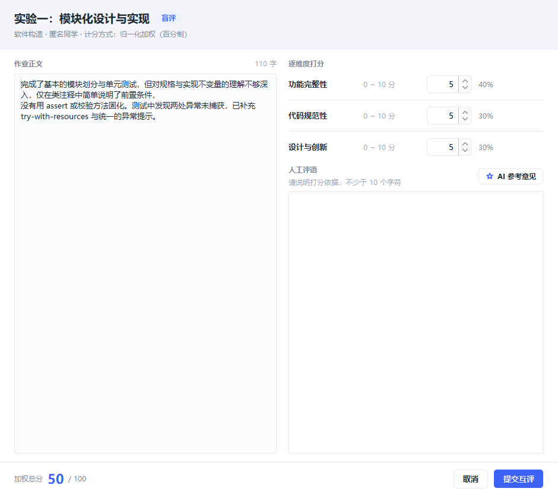
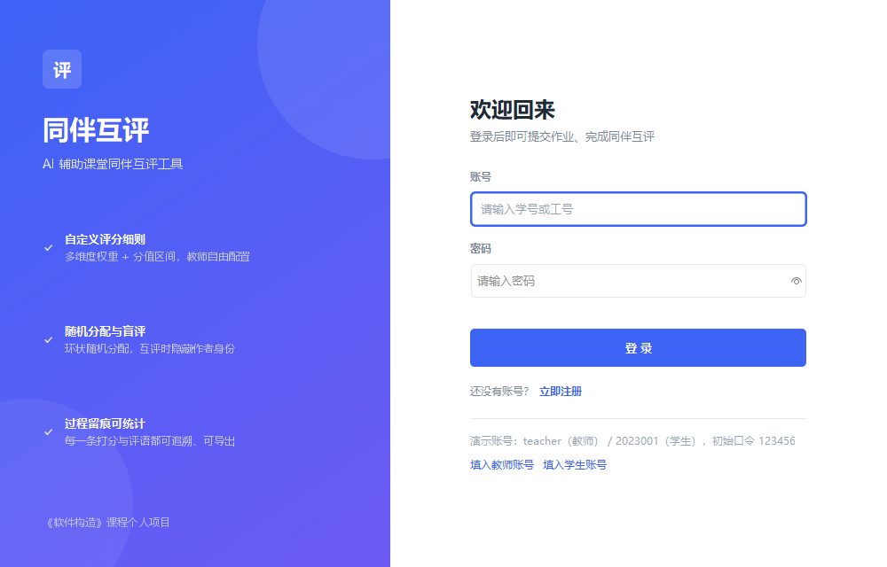
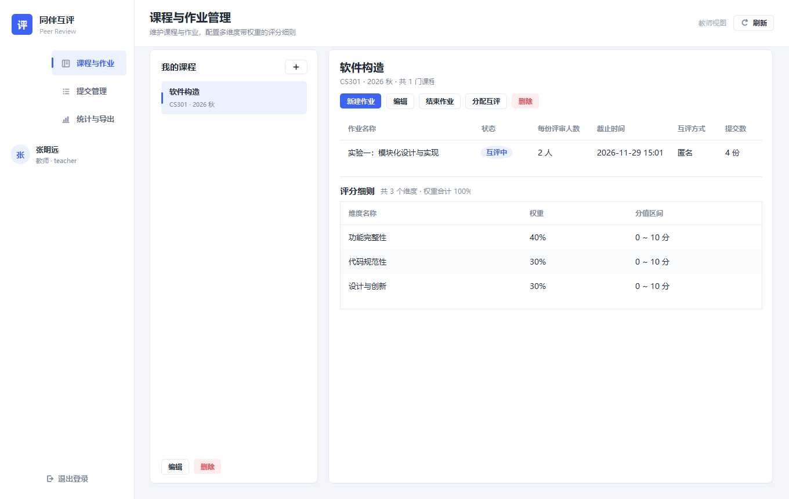
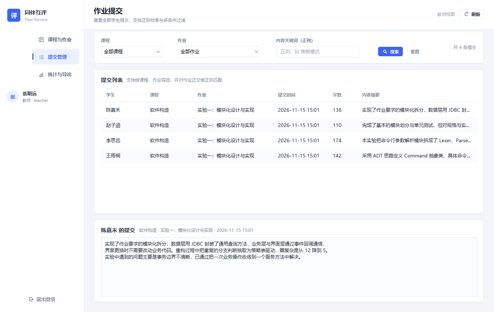
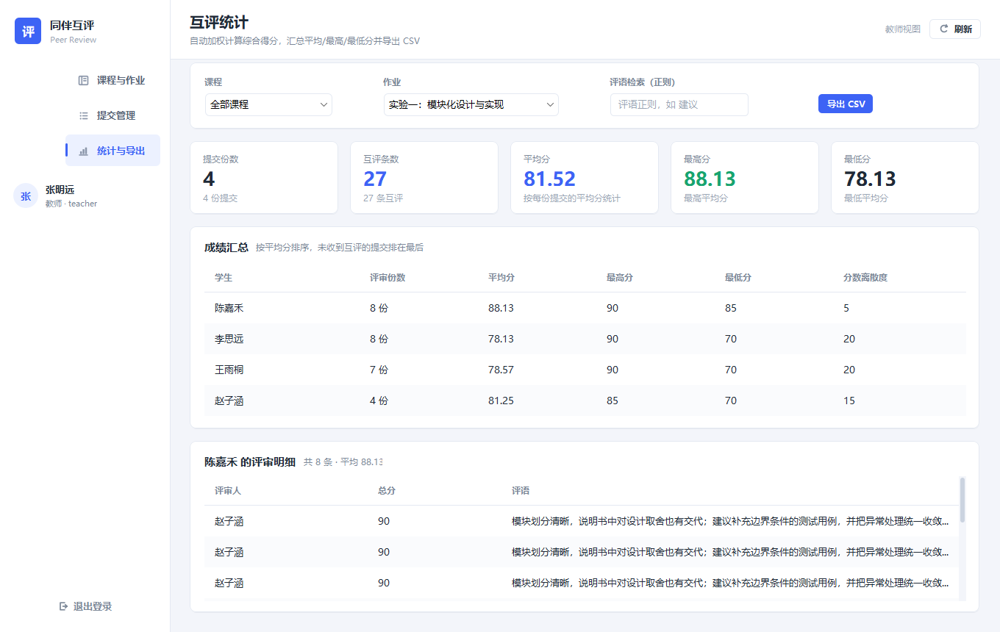
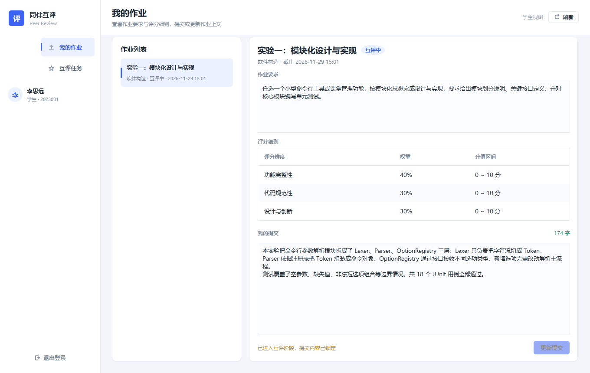
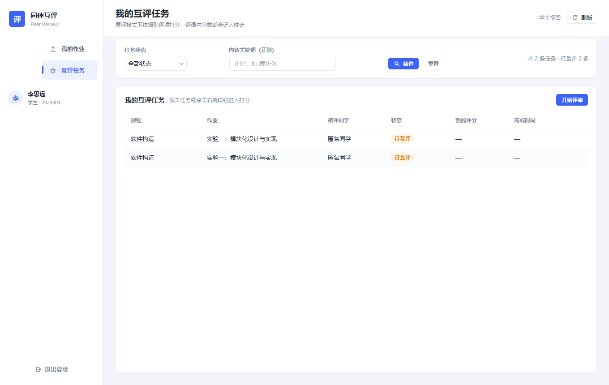
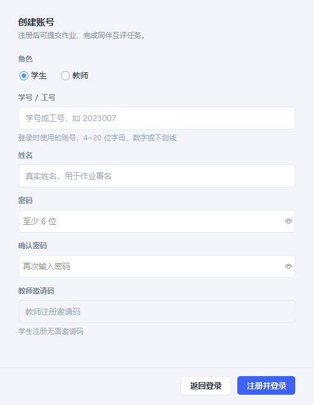
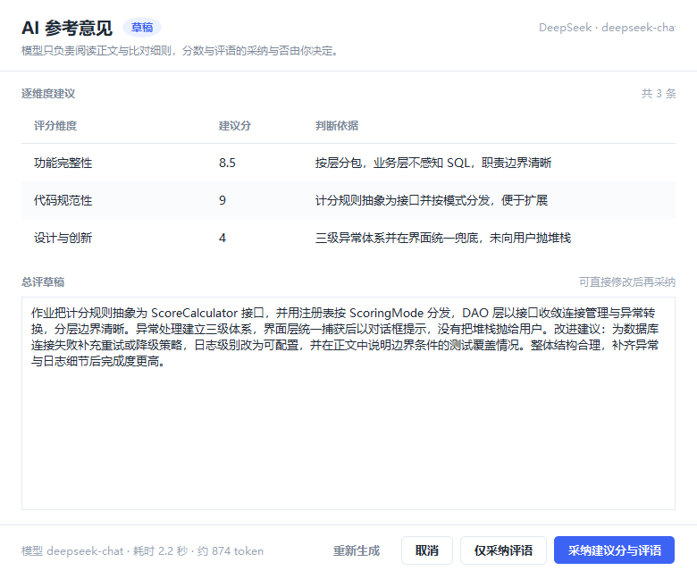

# 同伴互评工具（Java 桌面版）

《软件构造》课程个人项目：一个面向高校课程的 **AI 辅助课堂同伴互评工具**。

工具解决的核心问题不是「把数据存进表里」，而是把同伴互评这条业务链跑到闭环：
教师建课 → 布置作业并自定义评分细则 → 学生提交 → 教师随机分配（盲评） → 学生按细则逐维度打分写评语 → 系统加权汇总、统计、导出。

AI 在其中的位置是一支「助教铅笔」：它读正文、对细则、起草建议分与评语，但**分数与评语始终由学生确认后才落库**。



---

## 一、快速开始

### 环境要求

| 项 | 版本 |
| --- | --- |
| JDK | 17 及以上 |
| Maven | 3.8 及以上 |
| 数据库 | MySQL 8（可选）/ 内置 H2（免安装） |

### 方式 A：内置数据库，零依赖启动（推荐用于演示与验收）

```bash
mvn clean package
java -jar target/peer-review-tool.jar
```

Windows 下最省事的方式是双击项目根目录的 **`run.bat`**，它等价于在项目根执行上面的命令。

直接双击 `target\peer-review-tool.jar` 也可以：程序会自己定位应用根目录（向上寻找含 `pom.xml`
的目录），读到的仍是项目根这份配置，而不是在 `target\` 下另生成一份。启动日志第一行会打印
`应用根目录：...`，可据此确认配置读的是哪一份。

> 只有在「jar 被单独拷到别处」时才会就地生成配置（便携模式）：那个目录下没有 `config/`，
> 程序会用默认值新建一份，此时连不上 MySQL 属于预期，改该目录下的配置即可。
> 数据库连接失败弹窗会直接显示**当前使用的配置文件绝对路径**。

> 在 cmd 里手动启动时注意：`cd D:\path` **不带 `/d` 不会切换盘符**。
> 若当前在 `C:` 盘，命令看似执行成功，实际当前目录仍是 `C:\Users\...`，于是找不到 `target`。
> 正确写法是 `cd /d D:\work\end-project\gouzao\own_job`，或者先敲 `D:` 再 `cd`。

首次启动若连不上 MySQL，程序会弹窗询问「是否改用内置数据库」；点「使用内置数据库」即可，
该选择会写回 `config/config.properties`（`db.type=embedded`），下次启动不再询问。
数据文件位于 `data/peer_review.mv.db`，删掉即恢复全新状态（含演示数据）。

也可以直接改配置跳过询问：

```properties
db.type=embedded
```

### 方式 B：连接 MySQL

1. 修改 `config/config.properties`：

   ```properties
   db.type=mysql
   db.url=jdbc:mysql://localhost:3306/peer_review?useUnicode=true&characterEncoding=utf8&serverTimezone=Asia/Shanghai&useSSL=false&allowPublicKeyRetrieval=true
   db.username=root
   db.password=你的密码
   ```

2. `java -jar target/peer-review-tool.jar`

数据库**不需要手动创建**：连接时若报 `Unknown database`，程序会先用服务器级连接创建
`peer_review`（utf8mb4），再重试一次；表结构与演示数据在首次连接时一并建好。
若账号没有建库权限，程序会提示手动执行的建库语句。

认证失败、端口不通等错误的诊断信息会按 JDBC 错误码区分（例如「用户名或密码错误」
与「数据库服务未启动」是两条不同提示），不需要逐个参数试错。

> 两种方式共用同一套 DDL 与同一套 DAO：H2 以 `MODE=MySQL` 运行，SQL 方言与生产环境一致，
> 不存在「演示能跑、换 MySQL 就崩」的情况。

### 演示账号

| 角色 | 用户名 | 口令 | 说明 |
| --- | --- | --- | --- |
| 教师 | `teacher` | `123456` | 可见全部课程与作业，负责布置、分配、统计 |
| 学生 | `2023001` ~ `2023006` | `123456` | 可提交作业、完成互评任务 |

首次启动已内置一门演示课程 `CS301 软件构造`、一份作业「实验一：模块化设计与实现」（3 条评分细则、4 份提交）。

### 自助注册

登录页「还没有账号？立即注册」可创建新账号，注册成功直接进入主界面：

| 角色 | 需要什么 | 说明 |
| --- | --- | --- |
| 学生 | 学号 + 姓名 + 口令 | 直接注册，无需审核 |
| 教师 | 同上 + 邀请码 | 邀请码见 `config/config.properties` 的 `register.teacher.code`，默认 `TEACH2026` |

规则：账号 4~20 位字母/数字/下划线（纯数字学号与 `T2026` 这类工号都可）、密码 6~32 位且不能与账号相同、
两次输入必须一致、账号不可重复。把 `register.teacher.code` 改成空串即可关闭教师自助注册。

> 口令以 SHA-256 摘要落库，不保存明文。系统当前未做选课隔离：学生注册后即可看到全部课程与已发布作业。


### 配置 AI 辅助评审（DeepSeek）

AI 默认读取 `config/config.properties` 中的配置，改完重启生效：

```properties
ai.enabled=true
ai.base.url=https://api.deepseek.com
ai.model=deepseek-chat
ai.api.key=sk-你的密钥
ai.timeout.seconds=60
ai.temperature=0.3
```

- 密钥申请：<https://platform.deepseek.com/api_keys>
- `ai.enabled=false` 或 `ai.api.key` 留空时，打分窗口**不会出现**「AI 参考意见」入口，其余功能完全不受影响；
- 该文件含数据库口令与 API 密钥，已列入 `.gitignore`，不要提交到版本库；
- 想单独验证连通性：在 IDE 里直接运行 `tools/AiSmoke.java` 的 `main`，它读同一份配置并打印建议分与总评（会消耗一次真实额度）。

---

## 二、功能一览

| 任务书模块 | 实现位置 | 关键行为 |
| --- | --- | --- |
| 课程与作业管理 | `TeacherCoursePage`、`CourseEditorDialog`、`AssignmentEditorDialog`、`CourseService`、`AssignmentService` | 课程增删改查；作业含名称、描述、截止时间、匿名开关、每份评审人数、计分方式；**评分细则可动态增删**，每维度含权重、分值区间、排序 |
| 用户与作业提交 | `StudentAssignmentPage`、`SubmissionService`、`AuthService`、`RegisterDialog` | 教师 / 学生两类角色登录与**自助注册**（教师需邀请码）；学生提交文本作业并记录提交人、内容、时间；教师可查看全部提交；空提交、过短、超长、超期、角色越权均被拦截并给出可读提示；重复提交视为更新 |
| 互评任务分配与盲评 | `AllocationService`、`RandomRingAllocator`、`StudentReviewPage` | 教师一键随机分配，每份提交分给 N 名学生；盲评时界面只显示「匿名同学」；一个学生可收到多条待评；列表区分「待互评 / 已完成」 |
| 互评打分与评语 | `ReviewDialog`、`ReviewService` | 按细则逐维度打分（分值区间来自作业配置），右侧实时显示加权总分；评语不少于 10 字；落库存作业 ID、评审人、各项得分、加权总分、评语 |
| 检索过滤与统计输出 | `TeacherSubmissionPage`、`TeacherStatisticsPage`、`StatisticsService`、`SubmissionFilter`、`TaskFilter` | **正则表达式**检索作业正文与评语；**表驱动**多条件过滤（课程 / 作业 / 任务状态）；自动加权算综合分；统计平均分、最高分、最低分；导出带 BOM 的 UTF-8 CSV |
| 数据持久化 | `dao/*`、`db/*`、`config/AppConfig` | 手写 JDBC DAO（无 ORM）；配置保存在 `config/config.properties`；SQL 异常统一转换为带中文说明的 `DataAccessException`；操作留痕到 `logs/app.log` |
| GUI 桌面交互 | `LoginFrame`、`MainFrame`、`ui/page/*` | Swing + FlatLaf 扁平主题；`CardLayout` 单窗口多页面；侧栏按角色动态生成菜单 |
| **AI 辅助评审** | `ai/*`、`AiAssistDialog`、`DeepSeekSuggestionProvider` | 调用 DeepSeek 生成「逐维度建议分 + 总评草稿」；**人可采纳也可改写，AI 永不直接落库**；输出经越界裁剪与维度名校验；无密钥/断网自动隐藏或降级 |
| 软件质量保障 | `src/test/java/**` | JUnit 5 共 50 个用例：计分策略、随机分配、细则校验、完整业务流、AI 协议层、应用根定位、注册校验 |
| 重构与复用 | `domain/scoring`、`domain/allocation`、`ai`、`ui/Ui`、`ui/component` | 策略模式重构计分、分配与 AI 提供者；表驱动重构状态流转；自制复用工具类 `Ui` / `Text` / `Dates` / `CsvWriter` |
| 拓展项 | `AppLogger`、`ReviewTaskDao.exists`、`anonymous` 字段 | 日志记录分配、打分与 AI 调用；同一评审人重复评审做唯一约束冲突检测；匿名互评可按作业开关 |

---

## 三、界面

| 登录 | 课程与作业管理 |
| --- | --- |
|  |  |

| 提交检索（正则） | 成绩统计 |
| --- | --- |
|  |  |

| 学生提交 | 我的互评任务 |
| --- | --- |
|  |  |

**注册窗口**（登录页「立即注册」进入，教师角色才需要邀请码）：



**AI 参考意见窗口**（左：生成结果；打分窗口的入口在「人工评语」标题右侧）：



截图由 `tools/UiShot.java` 离屏渲染生成，用于回归检查排版，不参与业务逻辑；AI 窗口截图使用固定数据的假提供者，不消耗真实额度。

---

## 四、分层架构

```
ui（Swing 页面 / 弹窗 / 主题 / 构件）
        ↓ 只调用服务层，不写 SQL、不碰 JDBC
service（业务规则 + 事务边界 + 校验）
        ↓ 只依赖 DAO 接口
dao（接口） ← jdbc（实现）  domain（实体 / 值对象 / 策略）
        ↓
db（连接提供者、建表与种子数据）、config（本地配置文件）、common（工具与异常）
        ↑
ai（参考意见提供者：接口 + DeepSeek 实现，被 ui 与 AppContext 使用，不反向依赖 ui）
```

| 包 | 职责 | 允许依赖 |
| --- | --- | --- |
| `com.peerreview.ui` | 界面与交互，`LoginFrame` / `MainFrame` / 5 个业务页面 / 2 个弹窗 | `service`、`ai`、`domain` 的读模型 |
| `com.peerreview.service` | 业务流程、校验、状态流转、统计聚合 | `dao` 接口、`domain` |
| `com.peerreview.dao` / `dao.jdbc` | 数据访问契约与 JDBC 实现 | `domain`、`db` |
| `com.peerreview.domain` | 实体、枚举、读模型 record、评分/分配策略、细则校验 | 仅 `common` |
| `com.peerreview.ai` | AI 参考意见：提供者接口、DeepSeek 实现、提示词与输出解析 | `common`、`domain`、`config` |
| `com.peerreview.common` | 文本、日期、口令、正则、CSV、日志、异常体系 | 无 |
| `com.peerreview.db` / `config` | 连接提供者、建表、配置读写 | `common` |

约束靠构造器注入落实：`AppContext` 是唯一的组合根，界面拿到的服务对象全是接口实现，页面里没有 `new JdbcXxxDao()`。

---

## 五、关键设计

### 1. 计分规则：策略模式

```java
ScoreCalculator calculator = ScoreCalculators.of(assignment.getScoringMode());
double total = calculator.total(items, scores);   // 归一化百分制 / 直接加权
```

`NormalizedWeightedCalculator` 把各维度按区间折算成百分比再加权（权重和不为 100 也能算，除零时退化为等权）；
`RawWeightedCalculator` 直接按「得分 × 权重」加权（适合总分不是 100 的场景）。新增计分方式只需实现接口并在 `ScoreCalculators` 注册一行。

**重构前**是 `ReviewService` 里一个 40 行的 `if (mode == NORMALIZED) {...} else {...}`，分支内还有 3 处魔法数；
**重构后**计分逻辑从服务里彻底剥离，`ReviewService` 只负责校验与落库，计分策略可独立单元测试（`ScoreCalculatorTest` 5 个用例）。

### 2. 分配算法：策略 + 环状随机

`RandomRingAllocator` 先把提交顺序打乱形成环，再让每个评审人顺延领取后面 N 份。相比「每份提交独立随机抽 N 人」：
天然避免自评、同一份作业不会被同一人领两次、且每人评审数量严格相等（避免有人爆量）。算法通过 `ReviewAllocator` 接口注入，
随机源以 `Random` 传入，测试里可用固定种子复现。

### 3. 状态流转：表驱动

```java
TRANSITIONS.put(DRAFT,     Set.of(PUBLISHED));
TRANSITIONS.put(PUBLISHED, Set.of(DRAFT, CLOSED));
TRANSITIONS.put(ALLOCATED, Set.of(CLOSED));
TRANSITIONS.put(CLOSED,    Set.of());
```

新增状态只需改这张表，不必在 `changeStatus` 里追加 if/else。多条件过滤同样是表驱动：`SubmissionFilter` / `TaskFilter`
用 `EnumMap<Key, Predicate<T>>` 组装条件，界面上的下拉框与正则框各自对应一个 Key。

### 4. 读模型与表格

列表类界面统一使用 `record` 读模型（`SubmissionRow`、`TaskRow`、`ReviewRow`、`SubmissionStats`、`AssignmentSummary`），
一次联表查询即可拿到表格要展示的全部字段，避免页面里出现 N+1 次查询；`SimpleTableModel<T>` 用 `Column<T>` 描述列名、宽度与取值函数，
一个 `List<record>` 就能生成表格。

### 5. JDBC 模板

`AbstractJdbcDao` 把「取连接 → 绑定参数 → 执行 → 映射结果 → 关闭」收敛为 `query / queryOne / insert / update / inTransaction`，
子类只写 SQL 与 `RowMapper`，不再重复 try-with-resources 与异常包装。

### 6. AI 辅助评审：第三个策略 + 不可信输入

AI 接入点是同一个思路的第三次应用——把它也做成策略：

```java
public interface ReviewSuggestionProvider {
    boolean isAvailable();
    ReviewSuggestion suggest(SuggestionRequest request);   // 作业题面 + 细则 + 正文 → 建议分 + 总评
}
```

`AppContext` 按配置装配 `DeepSeekSuggestionProvider` 或空对象 `UnavailableSuggestionProvider`，
界面只问 `isAvailable()` 决定要不要显示按钮，**没有一处判空**。换成别的兼容 OpenAI 协议的模型只改 `ai.base.url` 与 `ai.model`。

三处关键取舍：

1. **模型的输出当作不可信输入处理**（`SuggestionParser`）。维度名对不上细则就丢弃该条；建议分越界就裁到区间内并对齐 0.5；
   整体不是合法 JSON 就降级成「整段文字当总评」。结果是界面拿到的数据一定能通过 `ReviewService.validateScores`，
   不会出现「点了采纳却提交失败」。
2. **人机边界写在类型里**。`AiAdoption` 只描述「学生采纳了什么」，`ReviewDialog.applyAdoption` 只负责往控件里填值，
   提交仍走原来的 `ReviewService.submit`。AI 模块没有任何写库入口，加不进评分表。
3. **失败即降级**。超时/401/余额不足/断网都被翻译成一句中文提示并在窗口内提供「重试」；
   未配置密钥时按钮根本不出现。AI 不可用不影响任何手动功能。

提示词侧另有两条约束：只喂作业内容、不喂作者与评审人身份（杜绝通过模型泄露评审关系）；
正文超过 6000 字时截断并注明，控制单次成本。实测一次调用约 2.2 秒、870 tokens。

---

## 六、数据库表结构

8 张表，全部只使用 MySQL / H2 通用语法，建表语句在 `db/Database.java`（幂等，启动时自动执行）。

| 表 | 说明 | 关键字段与约束 |
| --- | --- | --- |
| `app_user` | 用户 | `username` 唯一；`role` = TEACHER / STUDENT；口令存 SHA-256（加固定盐） |
| `course` | 课程 | `code`、`name`、`semester`、`teacher_id` |
| `assignment` | 作业 | `course_id`、`deadline`、`anonymous`、`reviewers_per_submission`、`scoring_mode`、`status` |
| `rubric_item` | 评分细则 | `assignment_id`、`name`、`weight`、`min_score`、`max_score`、`sort_no` |
| `submission` | 作业提交 | 唯一约束 `(assignment_id, student_id)`，保证一人一份；`submitted_at` / `updated_at` |
| `review_task` | 互评任务 | 唯一约束 `(submission_id, reviewer_id)`，从库层面挡住重复分配；`status` = PENDING / COMPLETED |
| `review` | 互评结果 | 唯一约束 `task_id`，一条任务只能提交一次；`total_score`、`comment` |
| `review_score` | 逐维度得分 | `review_id`、`rubric_item_id`、`item_name`、`score`（冗余维度名，便于历史成绩在细则变更后仍可读） |

状态流转：

```
      DRAFT ──发布──> PUBLISHED ──分配互评──> ALLOCATED
        ↑                 │                     │
        └──撤回────────────┘                     │
                          └──────结束────────────┴──> CLOSED
```

删除采用显式级联（`评分类 → 任务 → 提交 → 作业`），由服务层按序清理，避免依赖数据库外键导致 H2/MySQL 行为差异。

---

## 七、测试

```bash
mvn test
```

| 测试类 | 用例数 | 覆盖点 |
| --- | --- | --- |
| `ScoreCalculatorTest` | 5 | 归一化计分、直接加权、越界裁剪、权重和不为 100、空细则除零 |
| `RandomRingAllocatorTest` | 5 | 不重不漏、不自评、工作量均衡、固定种子可复现、提交不足报错 |
| `RubricValidatorTest` | 4 | 权重合计 100、区间合法、名称唯一、条数上限 |
| `WorkflowIntegrationTest` | 8 | 建课→布置→提交→分配→打分→统计→检索→导出→级联删除→自助注册（内存 H2 端到端） |
| `AiSuggestionProviderTest` | 11 | 协议解析、越界裁剪、编造维度丢弃、围栏/后缀容错、非 JSON 降级、401/402/超时提示、无密钥与关闭开关 |
| `AppHomeTest` | 4 | 应用根定位到项目根（而非 target/classes）、相对路径解析、系统属性覆盖、空属性忽略 |
| `AuthServiceTest` | 13 | 学生注册成功、注册后可登录、账号重复、密码不一致/过短/与账号相同/全空白、账号格式非法、姓名必填、教师邀请码错误与通过、关闭教师注册、角色缺省为学生 |

当前结果：`Tests run: 50, Failures: 0, Errors: 0`。

`AiSuggestionProviderTest` 用 JDK 自带的 `HttpServer` 起本地桩服务，**不联网、不消耗额度**，
但走的是真实 HTTP 往返与真实 JSON 解析，覆盖了从请求拼装到状态码翻译的完整路径。
另外 `tools/AiSmoke.java`（真实调用一次）与 `tools/AiAdoptCheck.java`（验证采纳回填到控件）是人工验收脚本，不参与 `mvn test`。

---

## 八、构建与打包

```bash
mvn clean package          # 编译 + 测试 + 打可执行胖包
java -jar target/peer-review-tool.jar
```

Windows 下若中文报错乱码，先设置 `set MAVEN_OPTS=-Dfile.encoding=UTF-8`；
运行程序建议 `java -Dfile.encoding=UTF-8 -jar ...`。

---

## 九、目录结构

```
own_job/
├── pom.xml                     Maven 配置（flatlaf / mysql / h2 / jackson / junit5 / shade）
├── run.bat                     Windows 启动脚本（切到项目根后启动 jar）
├── config/config.properties    本地配置（数据库、日志、AI 密钥），首次启动自动生成
├── data/                       内置 H2 数据文件
├── logs/app.log                运行日志（分配、打分、AI 调用、导出等关键动作）
├── docs/
│   ├── 课程设计报告.docx        课程设计报告（需求分析 / 模块分解 / UML / 表结构 / 重构 / 复用 / 测试 / 过程 / 体会）
│   ├── JUnit单元测试说明.docx   测试说明（环境 / 运行方式 / 50 个用例逐条说明 / 覆盖率 / 缺陷记录）
│   ├── 用户操作手册.docx        教师与学生操作手册（含 10 张界面截图与故障排查）
│   ├── img/                     报告与手册的配图（7 张 UML/ER 图 + 10 张界面截图）
│   └── *.md                     上述三份文档的 Markdown 源（可用 tools/build_docs.sh 重新生成）
├── shots/                      界面截图
├── tools/                      开发期工具（不打包进 jar）
│   ├── UiShot.java             离屏渲染所有界面，用于排版回归
│   ├── AiSmoke.java            真实调用一次 DeepSeek，检查连通性与输出质量
│   ├── AiAdoptCheck.java       验证「采纳 AI 草稿 → 回填控件」链路
│   ├── umlgen.py               生成 UML 类图 / 用例图 / 顺序图 / 状态图 / ER 图（纯 Pillow）
│   ├── md2html.py              Markdown → 学术排版 HTML（表格、代码块、图占位）
│   ├── insert_figures.py       把图占位替换为真实图片并加居中图注（python-docx）
│   ├── fix_page_setup.py       统一各节为 A4 并校正页边距
│   ├── tune_tables.py          按内容宽度重算表格列宽（避免宽表被压成窄条）
│   └── build_docs.sh           一键重建三份交付文档
└── src/main/java/com/peerreview/
    ├── Main.java               入口：配置 → 连接 → 主题 → 登录窗口
    ├── AppContext.java         组合根：装配 DAO、服务、AI 提供者
    ├── common/  config/  db/  基础设施
    ├── domain/                 实体、枚举、读模型、评分与分配策略、细则校验
    ├── ai/                     参考意见提供者接口、DeepSeek 实现、提示词与解析
    ├── dao/ jdbc 实现
    ├── service/                业务流程（含 query 过滤器）
    └── ui/                     主题、构件、页面、弹窗
```

---

## 十、AI 模块的边界与可替换性

任务书要求「AI 仅生成参考评审意见，人保留最终打分权」，这一点通过三个物理隔离落实：

1. **不写库**：`com.peerreview.ai` 里没有任何 DAO 或 Connection 引用，编译期就拿不到写库能力；
2. **不自动提交**：采纳只是把值填进 `JSpinner` 与 `JTextArea`，落库仍要学生自己点「提交互评」；
3. **可整体移除**：删掉 `ai` 包与 `ReviewDialog` 里那一个按钮，其余代码零改动——因为业务层从未依赖过它。

替换模型只需改配置；如果要换成校内自建网关，只要它兼容 `/chat/completions` 协议，改 `ai.base.url` 即可。
若要接别的厂商，实现 `ReviewSuggestionProvider` 并在 `SuggestionProviders.create` 里加一个分支，
提示词（`SuggestionPrompt`）与输出校验（`SuggestionParser`）可直接复用。
