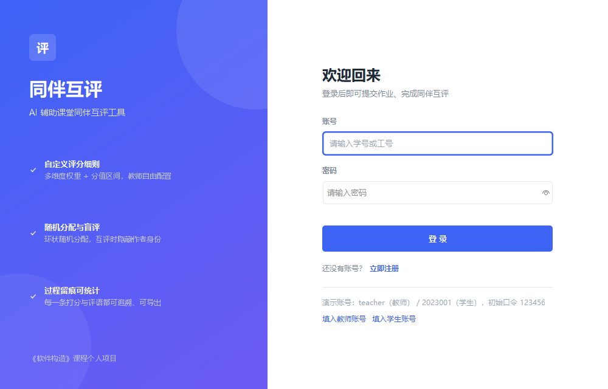
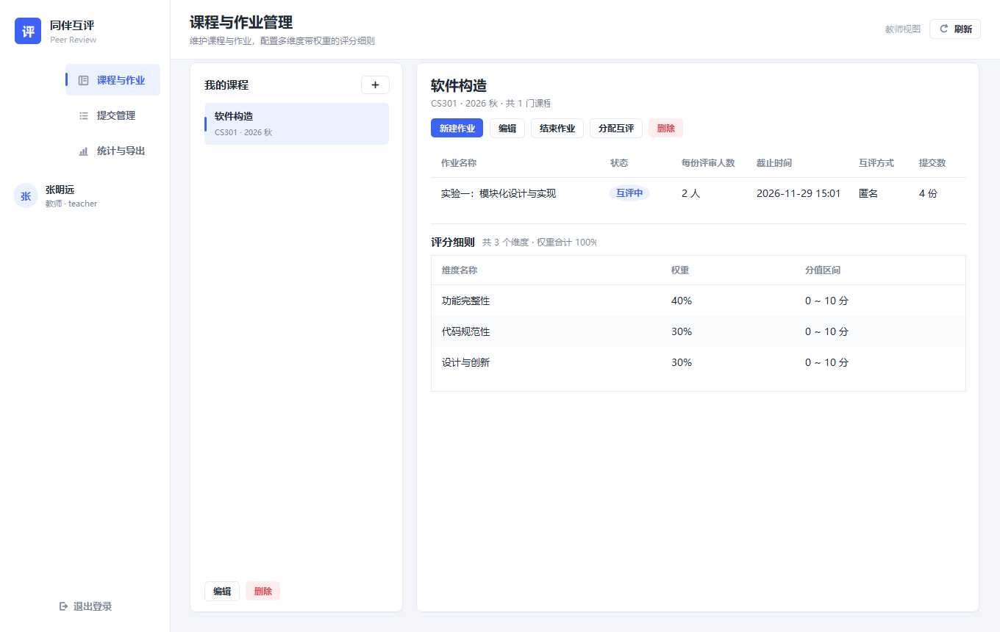
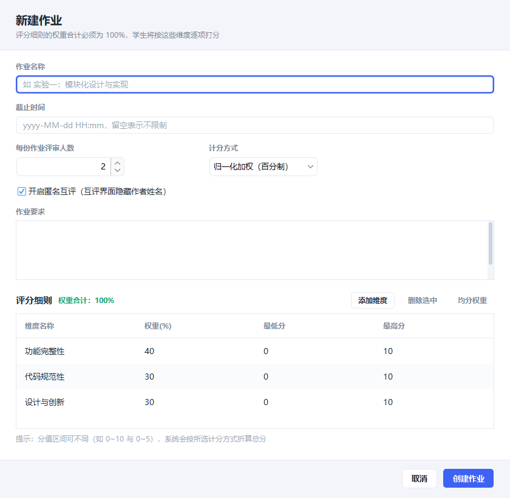
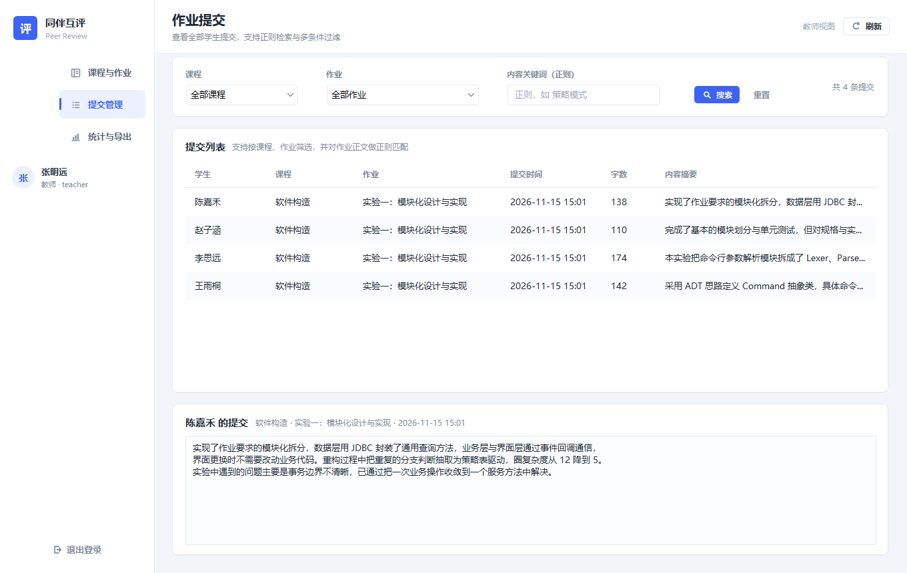
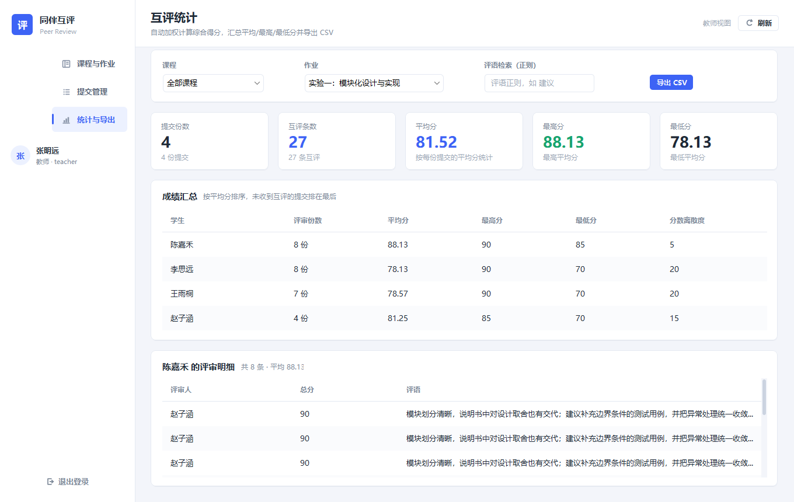
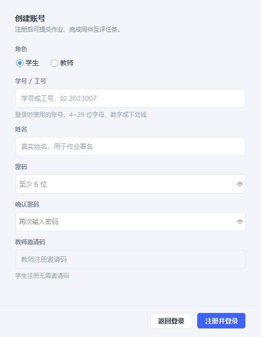
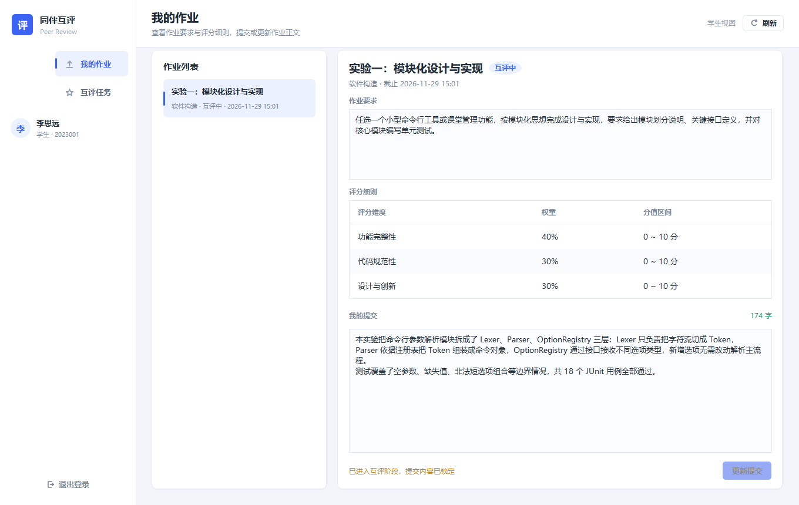
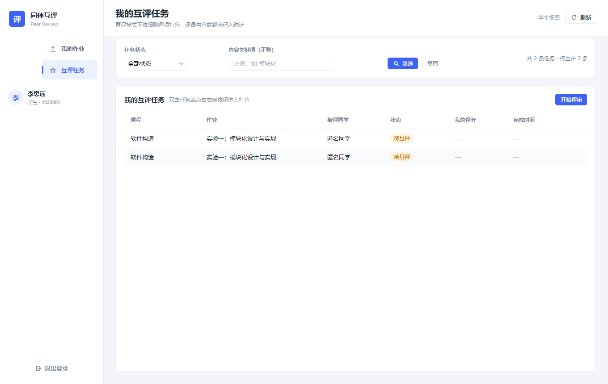
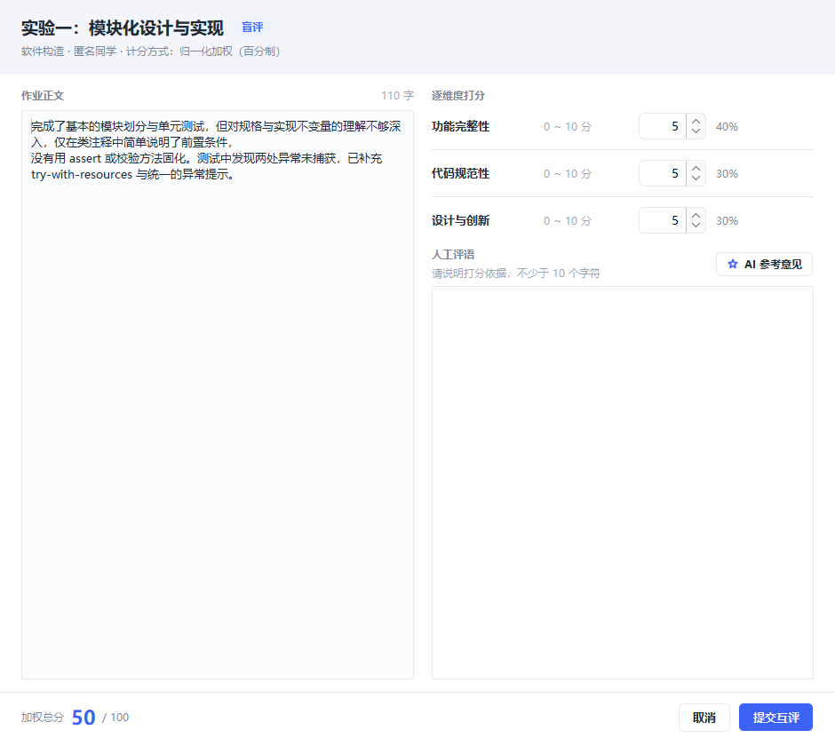
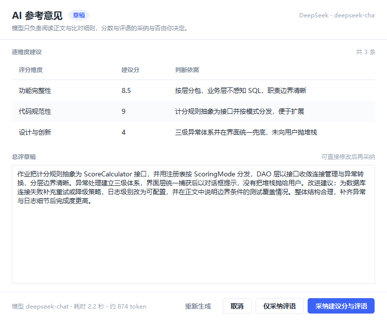

# 用户操作手册

## AI 辅助课堂同伴互评工具（Java 桌面版）

---

## 摘要

本手册面向使用本工具开展课堂同伴互评的教师与学生，按「准备环境 → 登录 → 教师流程 → 学生流程 → 故障排查」的顺序组织，
每一步都给出可对照的界面截图与操作结果说明。教师可按第 4 章完成一次完整布置与统计，学生可按第 5 章完成提交与互评。
阅读第 2 章与第 7 章（常见问题）可以在遇到问题时自助解决大部分情况。

**关键词：** 操作手册；同伴互评；教师流程；学生流程；故障排查

---

## 1 关于本手册

### 1.1 适用读者

| 读者 | 建议阅读 | 关注点 |
| --- | --- | --- |
| 教师 | 第 2、3、4、7 章 | 如何布置作业、配置细则、分配互评、查看统计与导出 |
| 学生 | 第 2、3、5、7 章 | 如何提交作业、完成互评、使用 AI 参考意见 |
| 系统管理员 | 第 2、6、8 章 | 安装、配置、数据库与日志位置 |

### 1.2 排版约定

| 约定 | 含义 |
| --- | --- |
| 「我的课程」 | 带引号的中文是界面上的按钮、标签或菜单文字 |
| 方框中的文字 | 提示框、对话框中的实际提示语 |
| 注意 / 提示 | 需要额外留意的地方 |
| `等宽字体` | 文件路径、配置项、命令 |

### 1.3 版本

本手册对应工具版本 1.0.0（2026 年 11 月）。界面若有更新，以实际界面为准。

---

## 2 安装与启动

### 2.1 环境要求

| 项 | 要求 | 说明 |
| --- | --- | --- |
| 操作系统 | Windows 10/11、macOS、Linux | 界面为 Swing，跨平台可用 |
| Java | JDK 17 或更高 | 已在 17 上验证；`java -version` 可检查 |
| 内存 | 512 MB 以上可用 | 桌面程序，无特殊要求 |
| 数据库 | MySQL 8（可选） | 不装 MySQL 也能运行，见 2.5 |
| 屏幕分辨率 | 1280×800 以上 | 低于此分辨率部分对话框需要滚动 |

### 2.2 获取与构建

方式一（推荐，使用构建好的包）：

```bash
java -jar peer-review-tool.jar
```

方式二（从源码构建）：

```bash
mvn clean package
java -jar target/peer-review-tool.jar
```

方式三（Windows 一键启动）：双击项目根目录的 `run.bat`。

> **提示**：`run.bat` 会自动切换到项目目录再启动，因此配置与数据文件始终定位到项目根，不会因为「从别的目录启动」而找不到配置。

### 2.3 首次启动会发生什么

1. 程序在启动目录下检查 `config/config.properties`，不存在则自动生成一份默认配置；
2. 按配置连接数据库（默认 MySQL）。若连接失败，会弹窗说明原因，并提供「使用内置数据库」选项；
3. 首次连接成功时自动建表，并写入演示数据：1 门课程、1 个作业、3 条评分细则、4 份学生提交；
4. 打开登录窗口。

日志文件位于 `logs/app.log`，启动日志第一行会打印「应用根目录」，排查问题时先看这一行。

### 2.4 连接 MySQL（可选）

在 MySQL 中新建数据库（程序也会尝试自动创建）：

```sql
CREATE DATABASE peer_review CHARACTER SET utf8mb4 COLLATE utf8mb4_general_ci;
```

然后编辑 `config/config.properties`：

```properties
db.type=mysql
db.url=jdbc:mysql://localhost:3306/peer_review?useUnicode=true&characterEncoding=utf8&serverTimezone=Asia/Shanghai&allowPublicKeyRetrieval=true
db.username=root
db.password=你的密码
```

### 2.5 没有 MySQL 怎么办

两种方式任选一种：

- 启动失败弹窗中点击「使用内置数据库」；
- 或直接修改配置：把 `db.type` 改为 `embedded`。

```properties
db.type=embedded
```

内置数据库为 H2（MySQL 兼容模式），数据文件位于 `data/` 目录。功能与 MySQL 完全一致，适合演示与验收。

### 2.6 启动故障排查

| 弹窗提示 | 原因 | 处理 |
| --- | --- | --- |
| 数据库账号或密码不正确 | 配置里的口令与实际不符 | 核对 `db.username` / `db.password` |
| 目标数据库不存在 | 库未创建且当前账号无建库权限 | 手工执行 2.4 的建库语句 |
| 当前账号没有建库/建表权限 | 用了只读账号 | 换有权限的账号，或改用内置数据库 |
| 无法连接数据库服务 | MySQL 未启动，或地址/端口不对 | 启动 MySQL 服务，确认 3306 端口 |
| 需要 allowPublicKeyRetrieval | MySQL 8 默认认证方式要求 | 在 `db.url` 末尾加 `&allowPublicKeyRetrieval=true` |
| Unable to access jarfile | 命令行当前目录不在 jar 所在目录 | 使用 `cd /d 项目路径`，或直接双击 `run.bat` |

---

## 3 界面总览

### 3.1 登录界面



- 左侧为项目说明，右侧为登录表单；
- 底部「填入教师账号」「填入学生账号」是演示用的快捷填充按钮；
- 「还没有账号？立即注册」进入注册窗口（见 5.1）。

### 3.2 主窗口结构

登录后进入主窗口，结构为「左侧导航 + 右侧内容区」：

| 角色 | 导航项 | 内容 |
| --- | --- | --- |
| 教师 | 我的课程 | 课程列表，进入后可管理作业与分配互评 |
| 教师 | 提交管理 | 全部提交的检索、查看、导出 |
| 教师 | 互评统计 | 按作业统计平均/最高/最低分与评审明细 |
| 学生 | 作业提交 | 可提交的作业列表与正文编辑器 |
| 学生 | 我的互评任务 | 待互评与已完成任务 |

窗口右下角显示当前登录身份；关闭主窗口即退出程序。

---

## 4 教师操作

### 4.1 登录

1. 输入账号 `teacher`、口令 `123456`（演示账号）；
2. 点击「登录」。

登录失败时提示会区分「账号不存在」与「口令不正确」，便于判断是记错账号还是记错口令。

### 4.2 创建课程

1. 进入「我的课程」；
2. 点击右上角「新建课程」；
3. 填写课程编码（如 `CS301`）、课程名称、学期；
4. 保存后课程卡片出现在列表中。



> **提示**：课程编码建议用教务系统一致的编号，后续导出成绩时便于与教务数据对应。

### 4.3 布置作业与配置评分细则

点击课程卡片进入作业列表，点「新建作业」打开编辑窗口：



需要填写或选择的内容：

| 项 | 说明 | 约束 |
| --- | --- | --- |
| 作业名称 | 显示在学生端 | 必填 |
| 作业要求 | 学生提交时可见的说明 | 可空 |
| 截止时间 | 格式 `yyyy-MM-dd HH:mm` | 可空（表示不限） |
| 互评方式 | 匿名 / 实名 | 匿名时学生端显示「匿名同学」 |
| 每份作业评审人数 | 1 ~ 10 | 不能超过「提交数 − 1」 |
| 计分方式 | 归一化加权 / 直接加权 | 见下方说明 |
| 评分细则 | 维度名、权重、分值区间 | 权重合计必须 100%，最多 12 条 |

**关于计分方式**：

- **归一化加权**（默认）：先把每个维度得分按其区间折算到 0~1，再按权重求和后乘 100。
  适合各维度分值区间不同的情况，例如「完整性 0~10、规范性 0~5」；
- **直接加权**：直接按「得分 × 权重%」求和。适合所有维度都是百分制的情况。

**关于评分细则**：

- 点「添加维度」新增一行，点行末「删除」移除；
- 权重后实时显示合计，不为 100% 时输入框下方出现红字提示，且无法保存；
- 分值区间要求下限小于上限；
- 维度名在同一作业内不能重复。

### 4.4 发布作业

在作业列表中点击「发布作业」，确认后状态由「草稿」变为「开放提交」，学生端即可看到并提交。

> **注意**：发布后仍可「撤回」回到草稿；一旦分配了互评（状态变为「互评中」），就只能「结束」，不能撤回。

### 4.5 分配互评

学生提交完成后，在作业上点击「分配互评」：

1. 系统按「每份评审人数」生成任务，采用环状随机分配；
2. 弹窗显示「共 X 份提交，每份 Y 人评审，将生成 N 条任务」；
3. 确认后任务写入，作业状态变为「互评中」，并给出「已完成分配：N 条任务」的提示。

分配遵循三条规则：不会自己评自己、同一份作业不会被同一人重复评审、每人的评审工作量相同。

**重复分配**：如果该作业已有任务，系统会提示「将清空这些任务并重新分配」，需要再次确认。
适用于「有学生退课需要重排」的情况。

### 4.6 查看提交与检索



- 顶部下拉框按「课程」「作业」筛选；
- 「内容关键词（正则）」支持正则表达式，例如 `模块化|分层` 检索包含任一关键词的正文，`异常.*处理` 检索顺序出现的两个词；
- 点「搜索」执行，点「刷新」清空条件；
- 正则写错时会提示「正则表达式不合法」，列表保持原样；
- 在左侧选择一条提交，右侧显示正文与评审明细。

### 4.7 查看统计与导出



统计页按作业列出每份提交的：评审份数、平均分、最高分、最低分、分数离散度（最高−最低）。
列表默认按平均分降序，未收到互评的提交排在最后并显示「待互评」而不是 0 分。

点击「导出 CSV」生成成绩汇总文件，文件名形如 `成绩汇总-CS301-实验一.csv`，默认保存在用户目录。
文件为 UTF-8 带 BOM，用 Excel 直接打开不会乱码。

### 4.8 结束作业与删除

- 「结束作业」：状态变为「已结束」，学生不能再提交或修改互评，统计冻结；
- 「删除作业」：会级联清理该作业的细则、提交、任务与评分，操作前有二次确认；
- 「删除课程」：同上，会先提示影响范围（几门课程、几份提交）。

> **注意**：删除是不可恢复的。期末归档前建议先导出 CSV。

---

## 5 学生操作

### 5.1 注册账号

在登录界面点击「还没有账号？立即注册」：



| 字段 | 规则 |
| --- | --- |
| 角色 | 学生 / 教师。选「学生」时邀请码输入框不可用 |
| 姓名 | 不超过 20 字，会显示给教师 |
| 学号 / 工号 | 4~20 位字母、数字或下划线，不能重复 |
| 密码 | 6~32 位，两次输入必须一致，且不能与账号相同 |
| 教师注册邀请码 | 仅教师角色需要，向任课教师索取 |

注册成功后直接进入主窗口，无需再次登录。错误提示显示在表单内（红字），已填写的内容会保留。

### 5.2 查看与提交作业



1. 进入「作业提交」，左侧列出可提交的作业（含截止时间与要求）；
2. 在右侧编辑正文，下方实时显示字数；
3. 点击「提交」。

规则：

- 正文 20 ~ 20000 字，过短或空白会被拒绝并提示；
- 同一作业只有一份提交，再次提交视为**更新**，不会产生第二条记录；
- 超过截止时间或作业已进入「互评中」，提交按钮不可用，正文只读。

### 5.3 查看我的互评任务



- 顶部显示「共 N 条任务 · 待互评 M」；
- 列表显示课程、作业、被评同学（盲评时显示「匿名同学」）、状态、完成时间；
- 双击一行或点「开始评审」进入打分窗口；
- 已完成的评价可点「查看评审」回看自己的打分与评语。

### 5.4 逐维度打分与写评语



1. 左侧显示被评作业正文，可滚动阅读；
2. 右侧按评分细则逐项打分，每项的输入框旁标出合法区间与满分；
3. 输入过程中「加权总分」实时更新，用于确认分数是否合理；
4. 在「人工评语」中说明打分依据，要求 10 ~ 2000 字；
5. 点击「提交互评」。

提交后任务状态变为「已完成」，并向教师统计提供数据。同一任务不能重复提交。
分数越界或评语过短时，会指出具体是哪一项、问题是什么。

### 5.5 使用 AI 参考意见

在打分窗口中，评语框右上方有「AI 参考意见」按钮（管理员关闭 AI 或未配置密钥时该按钮不出现）。



1. 点击后弹出窗口，显示「正在生成参考意见」；
2. 约 2 秒后显示三部分：逐维度建议分与理由、总评草稿、模型与耗时信息；
3. 总评草稿可以直接在窗口内编辑；
4. 点「采纳到打分表」，建议分会填入对应的打分框，总评填入评语框；
5. 回到打分窗口后**务必核对**：可以修改任何一项，再提交。

> **重要**：AI 只提供草稿，不会替你提交，也不会写入数据库。最终分数与评语由你确认后才会保存。
> 如果 AI 服务不可用（断网、密钥失效、余额不足），窗口会提示具体原因并允许重试，不影响你手动打分。

### 5.6 查看已提交的互评

在「我的互评任务」中把状态切到「已完成」，选中一条点「查看评审」，可看到当时每个维度的得分与评语（只读）。
提交后不可自行修改；如确需更正，请联系教师在结束后台处理。

---

## 6 管理员与配置

### 6.1 配置文件位置

配置文件为 `config/config.properties`，与程序根目录同级。若不确定实际读取哪个文件，查看 `logs/app.log` 第一行的「应用根目录」。

### 6.2 常用配置项

| 配置项 | 默认值 | 说明 |
| --- | --- | --- |
| `db.type` | `mysql` | 改为 `embedded` 使用内置数据库 |
| `db.url` / `db.username` / `db.password` | — | MySQL 连接参数 |
| `log.file` | `./logs/app.log` | 日志路径 |
| `register.teacher.code` | `TEACH2026` | 教师邀请码；设为空串即关闭教师自助注册 |
| `ai.enabled` | `true` | 置 `false` 后所有 AI 入口消失 |
| `ai.api.key` | 空 | DeepSeek 密钥；为空视为未启用 |
| `ai.model` | `deepseek-chat` | 模型名 |
| `ai.timeout.seconds` | `60` | 单次调用超时 |
| `ai.temperature` | `0.3` | 越低越稳定，评分场景建议保持低值 |

修改后需重启程序生效。

### 6.3 日志

`logs/app.log` 记录：登录、课程与作业变更、状态迁移、互评分配（含跳过原因）、打分（含总分）、导出路径、AI 调用（模型、耗时、token 数）。
**不记录作业正文与评语内容**，避免日志成为学生作业的副本。

### 6.4 数据备份

- MySQL：用 `mysqldump peer_review > backup.sql`；
- 内置数据库：直接复制 `data/` 目录。

---

## 7 常见问题

**Q1 双击 jar 没反应，或闪一下就退出？**
说明启动时抛了异常。用命令行运行 `java -jar peer-review-tool.jar` 可看到错误信息，再对照 2.6 的表处理。

**Q2 提示「数据库账号或密码不正确」，但我确认密码是对的？**
检查是否读到了另一个配置文件。看 `logs/app.log` 第一行的应用根目录，确认 `config/config.properties` 在该目录下。

**Q3 换了电脑，数据不见了？**
数据在数据库里，不在程序目录。MySQL 需要导出导入；内置数据库需要复制 `data/` 目录。

**Q4 作业发布后学生看不到？**
确认作业状态是「开放提交」，且学生账号能登录。当前版本没有选课隔离，所有学生都能看到已发布的作业。

**Q5 点「分配互评」提示提交数不足？**
至少需要 2 份提交才能互评。若只有 1 份，教师端可以看到该提交，但无法分配。

**Q6 分配人数写 5，但实际每份只有 3 人评？**
「每份评审人数」不能超过「提交数 − 1」，超出的部分会被拒绝并提示可分配上限。

**Q7 学生说看不到作者姓名，是对的么？**
是。匿名模式下学生端统一显示「匿名同学」，教师端始终可见真实作者，用于核对。

**Q8 学生提交错了内容，还能改吗？**
作业处于「开放提交」且未过截止时间时可以修改（重新提交即更新）。进入「互评中」后正文锁定。

**Q9 互评提交后发现打错了分，能改吗？**
学生端不支持自行修改。教师可在「互评统计」的评审明细中查看，必要时应结束作业后按流程处理。

**Q10 导出的 CSV 用 Excel 打开是乱码？**
本工具导出为 UTF-8 带 BOM，Excel 应能正确识别。若仍乱码，用「数据 → 从文本/CSV 导入」并选择 UTF-8。

**Q11 正则检索没有结果？**
正则区分大小写且需要完整匹配片段。先试普通关键词，再逐步加正则符号。写法非法时会有明确提示。

**Q12 AI 按钮不见了？**
可能是 `ai.enabled=false`，或 `ai.api.key` 为空。请联系管理员检查配置并重启。

**Q13 AI 提示「密钥无效」或「余额不足」？**
前者检查 `ai.api.key` 是否过期，后者需要为对应账号充值。两者都不影响手动打分。

**Q14 AI 生成的评语太空泛，怎么办？**
AI 只能依据正文与细则起草。若正文本身缺少可评价的技术细节，建议直接自己写；也可以先修改正文后重新生成。

**Q15 关闭 AI 弹窗后程序卡了一下？**
是后台请求被取消的瞬间，属于正常现象；1 秒内恢复。若长时间无响应，请查看日志。

---

## 8 附录

### 8.1 字段与规则速查

| 项目 | 规则 |
| --- | --- |
| 账号 | 4~20 位，字母/数字/下划线 |
| 密码 | 6~32 位，不得与账号相同 |
| 姓名 | ≤ 20 字 |
| 课程编码 | 建议与教务编号一致，≤ 32 字符 |
| 作业名称 | ≤ 128 字符 |
| 正文 | 20 ~ 20000 字 |
| 评语 | 10 ~ 2000 字 |
| 评分细则 | 1 ~ 12 条，权重合计 100%，下限 < 上限 |
| 每份评审人数 | 1 ~ 10，且 ≤ 提交数 − 1 |
| 截止时间格式 | `yyyy-MM-dd HH:mm` |

### 8.2 演示账号

| 角色 | 账号 | 口令 |
| --- | --- | --- |
| 教师 | `teacher` | `123456` |
| 学生 | `2023001` ~ `2023006` | `123456` |

演示数据含 1 门课程（CS301 软件构造）、1 个作业（实验一：模块化设计与实现，匿名，每份 2 人评审）、3 条评分细则与 4 份提交。

### 8.3 界面操作约定

| 操作 | 效果 |
| --- | --- |
| 单击表格行 | 选中并在右侧显示详情 |
| 双击互评任务 | 直接进入打分窗口 |
| 列表列头单击 | 按该列排序（部分列表支持） |
| 输入框失焦 | 校验并显示提示 |
| 关闭主窗口 | 退出程序（登录窗口随之关闭） |

### 8.4 文件位置

| 内容 | 位置 |
| --- | --- |
| 程序 | `peer-review-tool.jar` |
| 配置 | `config/config.properties` |
| 日志 | `logs/app.log` |
| 内置数据库数据 | `data/` |
| 导出的成绩 | 用户目录下的 `成绩汇总-*.csv` |
