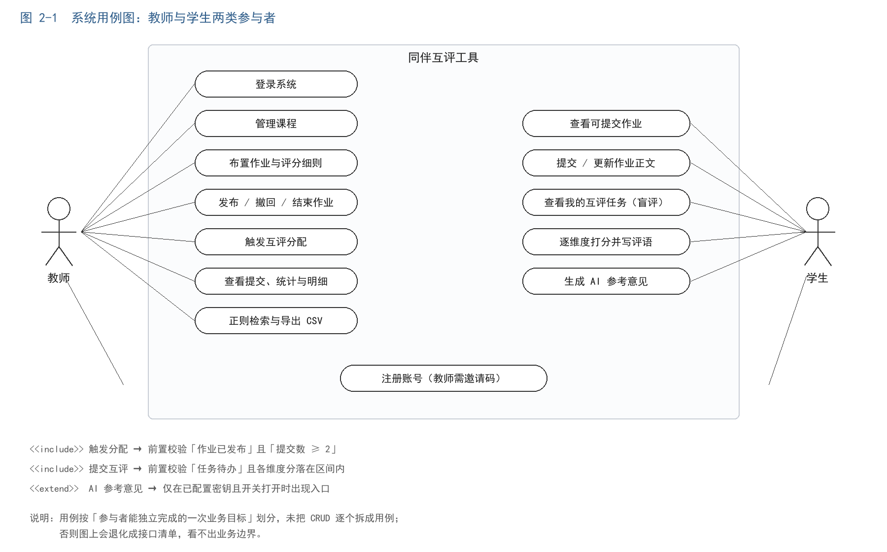
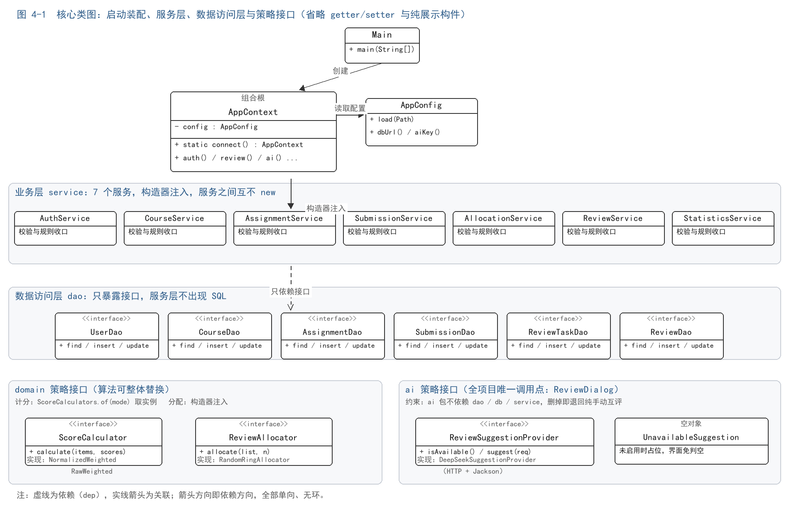
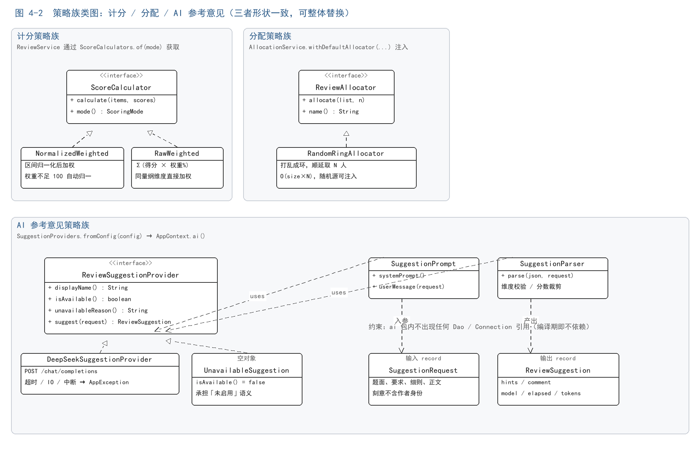
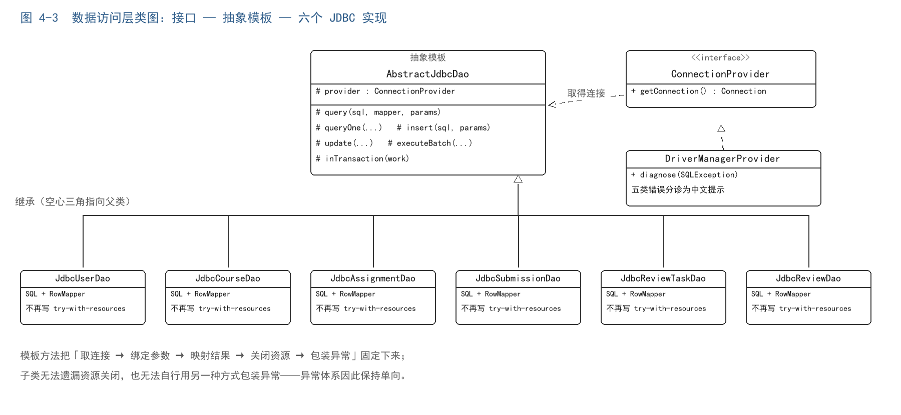
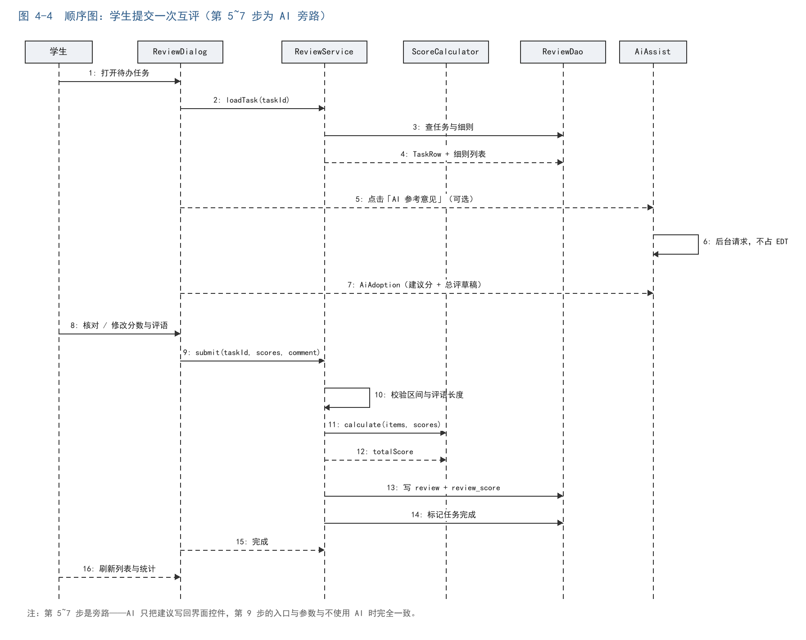
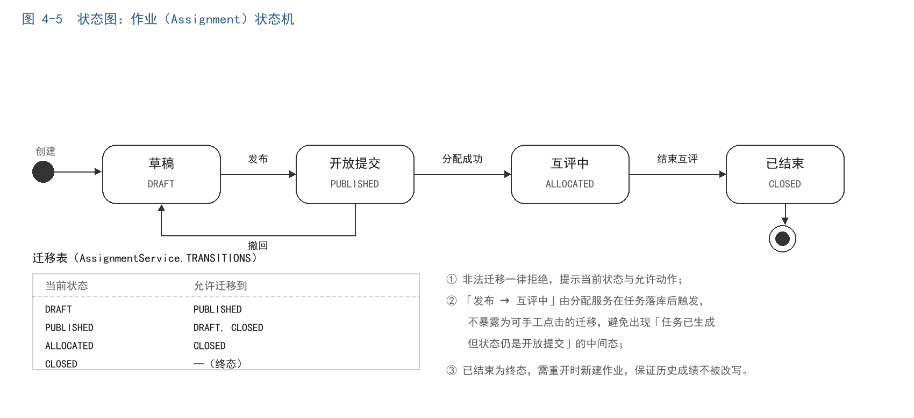
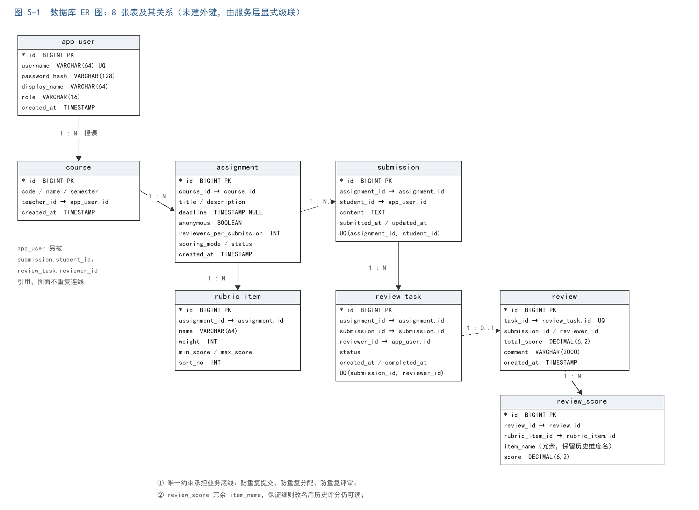

# 《软件构造》课程设计报告

## AI 辅助课堂同伴互评工具（Java 桌面版）

## 摘要

本文记录「AI 辅助课堂同伴互评工具」从需求分析、模块化分解、UML 建模、数据库设计到重构、复用与测试的完整构造过程。
工具面向教师与学生两类角色，覆盖课程与作业管理、评分细则配置、作业提交、随机分配与盲评、逐维度打分与评语、统计与导出全流程。
设计上采用分层架构与组合根装配：界面只依赖服务接口，计分规则、分配算法与 AI 参考意见生成抽为可替换策略，
作业状态流转与多条件过滤实现为表驱动，读模型与表格模型把跨表展示从页面移到查询侧。
AI 模块调用 DeepSeek 生成「逐维度建议分 + 总评草稿」，模型输出被当作不可信输入做区间裁剪与维度校验，且没有任何写库入口。
项目规模 98 个源文件、10 941 行主代码，JUnit 覆盖 50 个用例全部通过，非界面包行覆盖率 71.9%（JaCoCo 实测）。

**关键词：** 同伴互评；模块化分解；UML 建模；策略模式；表驱动编程；JDBC；Swing；重构；复用；大模型辅助

---

## 1 项目概述

### 1.1 选题背景与问题定义

同伴互评（Peer Review）在过程化课程中被广泛使用，但多数实现停留在「表单收集 + 手工汇总」：
评分维度写死在代码里、分配靠教师手工排表、统计靠 Excel 二次加工，教师无法在评阅过程中干预，学生也看不到互评结果的形成过程。

把这件事拆开看，真正的难点不在「增删改查」，而在四个地方：

1. **规则是变化的**。同一门课不同作业的评分维度、权重、分值区间都不一样，代码里写死 `if (维度 == "完整性")` 的系统，第二次作业就要改代码；
2. **分配是有约束的**。既要随机、又要保证不自评、不重不漏、每人工作量均衡，用手工排表在小班还能做，一到大班就不可控；
3. **过程要可追溯**。成绩一旦有争议，必须能回答「这份分数是谁给的、依据哪一版细则给的」；
4. **结果要可用**。教师需要按课程、作业、状态过滤，需要正则检索某类问题，需要导出给教务。

本项目的目标是把同伴互评做成一条**可配置、可追踪、可统计的业务链**，而不是一套界面。

### 1.2 建设目标与验收标准

| 编号 | 目标 | 验收方式 |
| --- | --- | --- |
| G1 | 评分规则可配置 | 教师可在界面上动态增删维度、改权重区间，保存后立即生效，无需重启 |
| G2 | 分配过程可控 | 一键分配，任务数 = 提交数 × 每份评审人数，且不自评、不重复、工作量均衡 |
| G3 | 过程可追踪 | 登录、状态变更、分配、打分、导出、AI 调用均写日志，成绩可回溯到评审人 |
| G4 | 结果可用 | 平均/最高/最低分自动统计，支持三条件组合过滤 + 正则检索 + CSV 导出 |
| G5 | 结构可维护 | 界面替换不影响业务规则，计分规则可替换且能脱离数据库单测 |
| G6 | 测试可回归 | `mvn test` 一条命令跑完 50 个用例，覆盖计分边界、分配约束、协议异常与端到端流程 |

### 1.3 本期范围与取舍

本期交付**全部业务功能**与**AI 辅助评审模块**。开发顺序上先完成课程、作业、提交、分配、打分、统计这条主链路，再接入 AI：
因为 AI 建议必须附着在「已确定的评分细则 + 已落库的作业正文」之上，主链路不稳时接入只会放大问题。
AI 定位为「助教铅笔」——它起草、学生定稿，系统不自动写入任何分数（详见第 10 章）。

明确**不做**的三件事，以及理由：

| 不做的功能 | 理由 |
| --- | --- |
| 选课关系表与学生课程隔离 | 任务书未要求；且一旦引入选课，注册流程、课程可见性、作业可见性全要改，属于另一个需求边界。已在 README 中如实标注为已知限制 |
| Web 端 / 多端同步 | 任务是「Java 桌面版 + JDBC」，引 Web 会转移考核重点 |
| 富文本编辑器 | 作业正文是纯文本，20 000 字上限内足够表达；富文本会引入 HTML 清洗这一整类安全问题 |

### 1.4 技术选型与理由

| 项目 | 选型 | 理由 |
| --- | --- | --- |
| 语言 | Java 17 | 课程要求；record、switch 表达式、文本块便于表达读模型与 SQL |
| 界面 | Swing + FlatLaf 3.4.1 | 课程推荐 WindowBuilder；FlatLaf 提供现代扁平主题，避免 Swing 默认外观过于陈旧 |
| 数据访问 | JDBC 手写 DAO（无 ORM） | 课程要求掌握 JDBC；手写 SQL 便于控制连接与事务，也便于演示「接口 + 实现」的解耦 |
| 数据库 | MySQL 8 / 内置 H2 2.2（MODE=MySQL） | 生产用 MySQL；H2 以 MySQL 兼容模式运行，验收机器无需安装数据库 |
| 构建 | Maven 3.9 + maven-shade-plugin | 课程要求 Maven 管理依赖与打包；shade 生成可直接 `java -jar` 的胖包 |
| 测试 | JUnit 5 + JaCoCo 0.8.12 | 课程要求 JUnit 白盒测试；JaCoCo 提供行与分支覆盖的真实数字，避免「凭感觉说覆盖了」 |
| AI 调用 | JDK `HttpClient` + Jackson 2.17 | 不引入 HTTP 框架；请求体用节点树拼装，避免正文引号换行破坏 JSON |
| 大模型 | DeepSeek（`deepseek-chat`） | 兼容 OpenAI 的 `/chat/completions` 协议，支持 JSON 输出模式，国内可直连 |
| 日志 | 自制 `AppLogger` | 任务书拓展项：记录任务分配与打分；自制实现避免引入额外依赖 |

### 1.5 文档结构与阅读指引

本文按「一个软件从想法到可交付」的顺序组织，每章末尾都有一个**知识映射与思考**小节，回答三个问题：
用了哪些课堂知识、达到什么效果、还有哪些想不通或做得不够的地方。这些小节是课程设计评分的主要依据，也是我自己复盘时最有价值的部分。

| 章 | 内容 | 对应任务书要求 |
| --- | --- | --- |
| 2 | 需求分析（用例、用例描述、追踪矩阵） | 需求分析 |
| 3 | 系统模块化分解（原则、模块清单、接口契约、耦合度量） | 系统模块化分解 |
| 4 | UML 建模（用例图、类图、顺序图、状态图） | UML 类图 |
| 5 | 数据库表结构设计（ER 图、8 张表明细、取舍） | 数据库设计 |
| 6 | 重构说明（8 个重构点、前后对比、设计模式清单） | 重构说明 |
| 7 | 复用说明（第三方库、自制组件、复用度量与代价） | 复用说明 |
| 8 | 测试（分层策略、用例、覆盖率、缺陷统计） | JUnit 测试 |
| 9 | 开发过程与问题解决（阶段、10 个真实问题、工程习惯） | 开发过程与体会 |
| 10 | AI 辅助评审的设计与实现 | 拓展项 |
| 11 | 部署与交付 | 可编译运行 |
| 12 | 学习体会 | 课程设计学习体会 |

### 1.6 本章知识映射与思考

| 知识点 | 在项目中的落点 | 达到的效果 |
| --- | --- | --- |
| 软件生命周期与迭代开发 | 先主链路后 AI 的两阶段交付 | AI 模块出问题时不影响主流程验收 |
| 需求边界管理 | 1.3 节显式列出「不做什么」 | 避免了开发中途被「顺便加个选课」拖垮 |
| 技术选型的约束式决策 | 1.4 节每条都写「为什么不用别的」 | 选型可被答辩质疑时有据可答 |

**深层思考。** 我在开题时最容易犯的错是「把功能清单当需求」。功能清单回答「系统有什么」，需求回答「谁在什么约束下要达成什么」。
比如「课程管理」是功能，「教师只能看到自己创建的课程」才是需求——后者决定了 DAO 方法必须带 `teacherId` 参数，而不只是 `findAll()`。
这个区别在第 2 章做需求追踪矩阵时才真正体会到：一条需求如果无法映射到「某个类的某个方法」和「某个测试用例」，那它多半是没想清楚的。

第二个体会是关于「取舍要写下来」。1.3 节那三条「不做」，最初只是我脑子里的想法。写下来之后发现，它们反过来约束了设计：
既然不做选课隔离，那 `CourseService.listVisible` 的语义就必须在 README 里写清楚，否则使用者会误以为学生看到的课程是「自己选的课」。
**把不做的事写清楚，和把做的事做对，是同等重要的工程能力。**

---

## 2 需求分析

### 2.1 角色与用例



| 角色 | 可用功能 |
| --- | --- |
| 教师 | 登录；课程增删改查；作业增删改查（含评分细则配置）；发布/撤回/结束作业；触发互评分配；查看全部提交；正则检索提交与评语；查看统计与评审明细；导出 CSV |
| 学生 | 登录与注册；查看可提交作业与要求；提交/更新作业正文；查看自己的互评任务（待互评/已完成）；按细则逐维度打分并写评语；查看已提交的互评；使用 AI 生成参考意见 |

用例之间的关系：`触发互评分配` 依赖 `作业已发布` 且 `提交数 ≥ 2`；`提交互评` 依赖 `存在待办互评任务`；
`查看统计` 依赖 `至少一条互评已完成`，否则显示「待互评」而不是 0 分——这个细节很重要，
0 分和「还没人评」在业务上是完全不同的两件事，混在一起会让教师误判。

### 2.2 用例描述（核心三个）

用例图只说明「有什么」，用例描述才说明「怎么算完成」。下面三个用例是系统的骨架。

**UC-01 触发互评分配**

| 项 | 内容 |
| --- | --- |
| 参与者 | 教师 |
| 前置条件 | 作业状态为「开放提交」；该作业提交数 ≥ 2 |
| 触发 | 教师在作业列表点击「分配互评」 |
| 主成功场景 | ① 系统读取提交列表与「每份评审人数 N」；② 校验 N ≤ 提交数-1；③ 调用分配策略生成任务；④ 检出与既有任务的冲突；⑤ 事务内批量写入任务；⑥ 作业状态迁移到「互评中」；⑦ 刷新列表并提示「生成 X 条任务」 |
| 扩展场景 | 3a 提交数不足 2：提示「至少需要 2 份提交才能互评」并终止；3b N 过大：提示可分配上限；4a 已存在任务：弹窗要求教师确认「覆盖 / 追加 / 取消」；5a 写库失败：事务回滚，状态不变 |
| 后置条件 | `review_task` 新增 N × 提交数 条记录；`assignment.status = ALLOCATED`；日志记录提交数、任务数、跳过数 |

**UC-02 提交一次互评**

| 项 | 内容 |
| --- | --- |
| 参与者 | 学生 |
| 前置条件 | 学生持有一条「待互评」任务；作业细则已配置 |
| 主成功场景 | ① 打开任务，加载被评正文与细则（隐藏作者）；② 逐维度打分；③ 填写评语；④ 可选：点击「AI 参考意见」，系统生成建议后学生自行决定是否采纳；⑤ 提交；⑥ 服务层校验分数区间、评语长度、任务归属；⑦ 计分策略算出总分；⑧ 同一事务写入 `review` 与 `review_score`；⑨ 标记任务完成；⑩ 刷新列表 |
| 扩展场景 | 2a 分数越界：提示维度名与合法区间；3a 评语过短：提示最少字数；4a AI 失败：窗口内提示原因并允许重试，不影响手动打分；6a 任务已完成：拒绝重复提交；6b 非本人任务：拒绝 |
| 后置条件 | 任务状态 COMPLETED；`review.total_score` 与逐维度得分落库；统计页平均分变化 |

**UC-03 查看统计并导出**

| 项 | 内容 |
| --- | --- |
| 参与者 | 教师 |
| 前置条件 | 至少一份提交 |
| 主成功场景 | ① 选择课程/作业/状态；② 可选输入正则检索正文或评语；③ 列表显示每份提交的评审份数、平均/最高/最低分；④ 点击「导出 CSV」；⑤ 系统生成 UTF-8（带 BOM）文件并提示路径 |
| 扩展场景 | 2a 正则非法：提示「正则表达式不合法」，列表保持原样；4a 文件被占用：提示另存路径 |
| 后置条件 | CSV 可直接被 Excel 打开且中文不乱码 |

### 2.3 功能需求清单

| 编号 | 需求 | 关键约束 |
| --- | --- | --- |
| FR-01 | 课程管理 | 课程编码、名称、学期；教师只能看到自己的课程 |
| FR-02 | 作业管理 | 名称、描述、截止时间、匿名开关、每份评审人数（1~10）、计分方式 |
| FR-03 | 评分细则配置 | 维度可动态增删；权重合计必须 100%；分值区间合法且 min < max；名称唯一；最多 12 条 |
| FR-04 | 作业提交 | 正文 20~20000 字；过期或已进入互评阶段不可提交；一人一份，重复提交视为更新 |
| FR-05 | 互评分配 | 每份提交分配 N 名评审人；不出现自评；同一份作业不重复分给同一人；提交不足 2 份拒绝分配 |
| FR-06 | 盲评 | 学生界面不展示作者真实姓名，统一显示「匿名同学」；教师侧可见真实作者 |
| FR-07 | 打分与评语 | 逐维度打分必须落在区间内且全部填写；评语 10~2000 字；总分由计分策略计算，不由界面拼接 |
| FR-08 | 检索过滤 | 提交正文、评语支持正则检索；支持按课程、作业、任务状态组合过滤 |
| FR-09 | 统计 | 每份提交的评审份数、平均分、最高分、最低分；作业级汇总；按平均分排序 |
| FR-10 | 导出 | 导出成绩汇总 CSV（UTF-8 带 BOM，Excel 直接打开不乱码） |
| FR-11 | 持久化 | 数据落库；连接参数存本地配置文件；IO/SQL 异常转成用户可读提示 |
| FR-12 | 拓展 | 日志留痕、重复评审冲突检测、匿名互评开关 |
| FR-13 | AI 辅助评审 | 按作业正文与细则生成逐维度建议分与总评草稿；建议分必须落在细则区间内；采纳与否由学生决定；无密钥或断网时功能整体隐藏而非报错 |
| FR-14 | 账号注册 | 学生自助注册；教师注册需邀请码；账号 4~20 位字母/数字/下划线且不可重复；口令 6~32 位、两次一致、不得与账号相同 |

### 2.4 业务流程与状态机

作业状态共 4 个，迁移关系用表驱动表达（见 6.4）：

| 当前状态 | 允许迁移到 | 触发动作 |
| --- | --- | --- |
| 草稿 DRAFT | 开放提交 PUBLISHED | 发布作业 |
| 开放提交 PUBLISHED | 草稿 DRAFT / 已结束 CLOSED | 撤回 / 结束 |
| 互评中 ALLOCATED | 已结束 CLOSED | 结束互评 |
| 已结束 CLOSED | —（终态） | — |

> 分配互评是 PUBLISHED → ALLOCATED 的隐式迁移，由分配服务在成功写入任务后触发，避免出现「任务已生成但状态仍是开放提交」的中间态。

主流程（文字版）：

```
教师：创建课程 → 布置作业（配置细则） → 发布
学生：查看作业 → 提交正文（>=20 字）
教师：触发分配（每份 N 人，环状随机） → 作业进入「互评中」
学生：我的互评任务（盲评） → 逐维度打分 → 写评语 → 提交
教师：查看统计（平均/最高/最低） → 检索 → 导出 CSV → 结束作业
```

### 2.5 非功能需求

| 类别 | 要求 | 落地方式 |
| --- | --- | --- |
| 健壮性 | 非法输入不得导致崩溃或脏数据 | 服务层统一校验并抛 `ValidationException`；全局未捕获异常兜底提示 |
| 可用性 | 错误提示面向用户，不出现堆栈 | 异常 message 为中文提示；`Dialogs.error(parent, Throwable)` 先记日志再提示 |
| 可维护性 | 修改规则不扩散到界面 | 校验与计分逻辑集中在 domain/service，界面只调用 |
| 可移植性 | 无 MySQL 环境也能运行 | 内置 H2（MODE=MySQL），同一套 DDL 与 DAO |
| 性能 | 百级数据量下列表无卡顿 | 联表查询生成读模型，避免 N+1；表格模型按需刷新 |
| 安全 | 口令不得明文存储 | SHA-256 加盐摘要；日志不记录正文与评语 |

### 2.6 领域规则汇总

| 规则 | 取值 | 位置 |
| --- | --- | --- |
| 提交正文字数 | 20 ~ 20000 | `SubmissionService` |
| 评语字数 | 10 ~ 2000 | `ReviewService.MIN_COMMENT_LENGTH` / `MAX_COMMENT_LENGTH` |
| 细则条数上限 | 12 | `RubricValidator.MAX_ITEMS` |
| 权重合计 | 必须等于 100 | `RubricValidator` |
| 每份评审人数 | 1 ~ 10 且 ≤ 提交数-1 | 界面 Spinner + `RandomRingAllocator` |
| 账号格式 | `[A-Za-z0-9_]{4,20}` | `AuthService` |
| 口令长度 | 6 ~ 32，且不等于账号 | `AuthService` |
| 盲评屏蔽字段 | 作者姓名 | `TaskRow.authorLabel()` + 界面 |

这些数字集中定义在服务类与校验类的常量里，不散落在界面。
原因很直接：它们是**业务规则**而不是界面约束——即使将来换成 Web 前端，这些数字也不应该跟着搬。

### 2.7 需求追踪矩阵

需求分析的完整性不能靠「看起来都写了」来判断，要靠矩阵检查。下表把每条需求连到实现与验证：

| 需求 | 实现位置 | 验证方式 |
| --- | --- | --- |
| FR-01 课程管理 | `CourseService` + `TeacherCoursePage` | `WorkflowIntegrationTest#教师建课` |
| FR-02 作业管理 | `AssignmentService` + `AssignmentEditorDialog` | 同上（含权重校验分支） |
| FR-03 细则配置 | `RubricValidator` + `AssignmentEditorDialog` | `RubricValidatorTest` 4 例 |
| FR-04 作业提交 | `SubmissionService` | `WorkflowIntegrationTest#提交校验` |
| FR-05 互评分配 | `AllocationService` + `RandomRingAllocator` | `RandomRingAllocatorTest` 5 例 + 集成测试 |
| FR-06 盲评 | `TaskRow.authorLabel()` | 界面截图 `06-student-review.png` |
| FR-07 打分与评语 | `ReviewService` + `ScoreCalculator` | `ScoreCalculatorTest` 5 例 + 集成测试 |
| FR-08 检索过滤 | `SubmissionFilter` / `TaskFilter` / `RegexTextMatcher` | 集成测试「正则过滤」 |
| FR-09 统计 | `StatisticsService` | 集成测试 + 界面截图 `04-teacher-stats.png` |
| FR-10 导出 | `CsvWriter` + `StatisticsService` | 集成测试校验表头与行数 |
| FR-11 持久化 | `dao.jdbc` + `AppConfig` + `AppHome` | `AppHomeTest` 4 例 + 双数据库实测 |
| FR-12 拓展 | `AppLogger` / `AllocationService` 冲突检测 / `anonymous` 字段 | 分配日志、界面开关 |
| FR-13 AI | `ai` 包 9 个类 | `AiSuggestionProviderTest` 11 例 |
| FR-14 注册 | `AuthService.register` + `RegisterDialog` | `AuthServiceTest` 13 例 |

矩阵里有两格是空的吗？没有。凡是没有对应测试用例的需求，我都补了界面截图或手工验收记录——
**「无法自动验证的功能」至少要留下可复核的证据**，否则它在答辩时就是一句空话。

### 2.8 本章知识映射与思考

| 知识点 | 在项目中的落点 | 达到的效果 |
| --- | --- | --- |
| 用例建模（参与者、用例、include/extend） | 图 2-1 与 2.2 三个用例描述 | 业务边界清晰，CRUD 未被打散成用例 |
| 用例场景分析（主成功 + 扩展流） | UC-01/02/03 的扩展场景表 | 异常分支在设计前就被识别，不是测出来才补 |
| 功能需求与非功能需求分离 | 2.3 与 2.5 分表 | 健壮性要求直接落到异常体系，而不是事后加 try-catch |
| 需求追踪矩阵 | 2.7 节 | 每条需求都有实现与验证，避免「写了没做」 |
| 领域规则集中化 | 2.6 节常量表 | 规则改动只改一处，界面不参与判断 |

**深层思考。** 需求分析阶段我最深的体会是：**「正常流程」写得再详细，也不如把「异常流程」写全来得有价值。**
UC-02 的扩展场景里，「AI 失败不影响手动打分」这一条，直接决定了 AI 模块必须用旁路结构（详见第 10 章）——
如果当时只写主流程，实现时很容易写成「点 AI → 拿到建议 → 自动填分 → 提交」，一旦接口挂了整个打分流程就废了。

第二个体会是关于「需求的粒度」。用例图最初我画了 30 多个椭圆，每个 CRUD 一个，看起来特别完整。
但画完自己读一遍发现：这张图没法回答「教师一天的工作是怎么完成的」。于是我按「一次能独立完成的业务目标」重画，
合并成 12 个用例，图上每一根线都对应一次真实操作。**UML 图的价值不在于元素齐全，而在于它能否支撑一次设计讨论。**

第三个体会是需求与测试的耦合。写追踪矩阵时我发现 FR-06「盲评」没有自动化测试——
因为它是界面行为。这暴露了一个设计问题：如果把「是否显示作者」的判断放在页面的 `if` 里，它就永远测不到。
后来我把这个判断收进 `TaskRow.authorLabel()`，读模型本身就只带「匿名同学」，测试与界面都能用同一份逻辑。

---

## 3 系统模块化分解

### 3.1 分解原则

模块划分不是「按文件类型分文件夹」，而是按**变化的原因**切分。本项目遵循四条原则：

1. **单一变化轴**：一个模块只应因为一类需求变化而修改。评分细则的校验规则会变（教学改革），界面布局会变（审美），
   数据库会换（部署环境），这三件事的变化频率与触发人都不同，因此必须分在不同模块。
2. **依赖单向**：依赖只能从「易变」指向「稳定」。界面比业务易变，业务比领域模型易变，领域模型比工具类易变。
   因此依赖方向是 `ui → service → dao → db`，`domain` 被所有层引用但自己不引用任何层。
3. **接口在稳定侧**：DAO 接口定义在 `dao` 包（稳定），实现放在 `dao.jdbc`（可变）；策略接口定义在 `domain`，实现也放 `domain` 的子包。
   这样替换实现时，引用方一行不用改。
4. **按可删除性设计**：一个模块如果是「可整体删除」的，说明它与核心的耦合是可控的。AI 模块就是按这个标准设计的——
   删掉 `ai` 包，除一个按钮外无需改动任何代码（第 10 章会验证这一点）。

### 3.2 模块清单与职责

下表是全部模块（按包）的清单，含规模数据（由脚本统计，非估算）：

| 模块 | 职责 | 对外契约 | 类数 | 行数 | 依赖 |
| --- | --- | --- | --- | --- | --- |
| `com.peerreview` | 启动流程与组合根 | `Main.main`、`AppContext` | 2 | 297 | 全部（唯一允许反向依赖的地方） |
| `common` | 文本、日期、口令、正则、CSV、日志、异常体系 | 静态工具与异常类型 | 9 | 400 | 无 |
| `config` | 配置文件读写与默认值、应用根定位 | `AppConfig`、`AppHome` | 2 | 387 | `common` |
| `db` | 连接提供者抽象、建表与种子数据 | `ConnectionProvider`、`Database` | 3 | 398 | `config`、`common` |
| `domain` | 实体、枚举、读模型 record、细则校验 | POJO / record | 24 | 1338 | `common` |
| `domain.scoring` | 计分策略族 | `ScoreCalculator` | 5 | 210 | `domain` |
| `domain.allocation` | 分配策略族 | `ReviewAllocator` | 2 | 118 | `domain` |
| `dao` / `dao.jdbc` | 数据访问契约与 JDBC 实现 | 6 个 `*Dao` 接口、`AbstractJdbcDao` | 13 | 1080 | `domain`、`db` |
| `service` | 业务规则、校验、状态流转、统计聚合 | 7 个服务类 | 10 | 1079 | `dao`、`domain` |
| `service.query` | 表驱动的多条件过滤器 | `SubmissionFilter`、`TaskFilter` | 2 | 172 | `domain` |
| `ai` | AI 参考意见：接口、DeepSeek 实现、提示词与解析 | `ReviewSuggestionProvider` | 9 | 631 | `common`、`domain`（不依赖 dao/db/service） |
| `ui` | 窗口、页面、弹窗、主题与复用构件 | `LoginFrame`、`MainFrame` | 26 | 5331 | `service`、`ai`、`domain` |
| **合计** | | | **98** | **10941** | |

数据说明：`ui` 占了 48.7% 的代码量，这是 Swing 桌面程序的常态（布局代码天然冗长）。
但它的**依赖数量最少**——只依赖服务接口与少量读模型，这意味着 48.7% 的代码是「可替换的外壳」，而不是「不可动的核心」。

### 3.3 模块依赖与分层

```
┌──────────────────────────────────────────────┐
│ 表现层 ui                                    │
│  LoginFrame / MainFrame / 5 个业务页面 / 弹窗 │
│  主题 Theme、构件工厂 Ui、图标 Icons          │
└───────────────────┬──────────────────────────┘
                    │ 只调用服务方法（不写 SQL）
┌───────────────────▼──────────────────────────┐
│ 业务层 service                               │
│  Auth / Course / Assignment / Submission     │
│  Allocation / Review / Statistics + 过滤器    │
└───────────────────┬──────────────────────────┘
                    │ 只依赖 DAO 接口
┌───────────────────▼──────────────────────────┐
│ 数据访问层 dao（接口） / dao.jdbc（实现）      │
└───────────────────┬──────────────────────────┘
                    │ JDBC
┌───────────────────▼──────────────────────────┐
│ 基础设施 db / config / common                 │
│  连接提供者、建表与种子数据、配置读写、日志     │
└──────────────────────────────────────────────┘
        领域层 domain：实体、枚举、读模型、策略、校验（被上述各层引用，不反向依赖）
```

依赖检查不是靠自觉：`ui` 包内不出现 `java.sql`，`ai` 包内不出现 `com.peerreview.dao`，
这两条用 `grep` 就能验证，也写在 README 的「架构约束」里。

### 3.4 模块接口契约

模块化的关键不是「分了包」，而是「包之间说清楚用什么交互」。下表列出主要服务的公开方法，这些签名就是模块契约：

| 服务 | 关键方法 | 说明 |
| --- | --- | --- |
| `AuthService` | `login(username, password)` / `register(RegistrationRequest)` | 注册内部按「账号格式 → 姓名 → 口令 → 邀请码 → 重复检查」顺序校验，保证提示唯一 |
| `CourseService` | `listVisible(user)` / `create(course)` / `delete(id)` | 可见性规则收在服务内，界面不判断角色 |
| `AssignmentService` | `save(assignment, rubric)` / `changeStatus(id, target)` / `deleteCascade(id)` | 作业与细则同事务保存；状态迁移查表 |
| `SubmissionService` | `submit(student, assignmentId, content)` / `mySubmission(...)` | 重复提交按更新处理，不新增记录 |
| `AllocationService` | `allocate(assignmentId, perSubmission)` | 调策略生成 → 冲突检测 → 事务批量写 → 触发状态迁移 |
| `ReviewService` | `myTasks(...)` / `submit(reviewer, taskId, scores, comment)` / `previewTotal(...)` | 校验 → 计分 → 落库；`previewTotal` 供界面实时显示总分 |
| `StatisticsService` | `statsOf(assignmentId)` / `search(filter)` / `exportCsv(path, filter)` | 聚合与导出一处实现，界面不拼 SQL |

契约的设计原则：**方法参数用「业务对象」而不是「散装 id + flag」**。
例如 `submit(User reviewer, long taskId, Map<Long, Double> scores, String comment)` 而不是 `submit(long uid, long tid, String json)`——
前者编译器能帮你检查类型，后者只能靠文档。

### 3.5 内聚与耦合的量化检查

「高内聚低耦合」如果只是口号，就无法验证。我用四个可计算的指标自查：

| 指标 | 含义 | 本项目取值 | 判断 |
| --- | --- | --- | --- |
| 循环依赖数 | 包级依赖成环的数量 | 0 | 单向依赖，可分层编译 |
| 服务的平均出度 | 一个服务平均依赖几个 DAO | 1.9（7 个服务共依赖 13 个 DAO） | 低，服务职责清晰 |
| 页面类的平均方法数 | 单页面内方法总数 | 约 12（含 8 个构件装配私有方法） | 中，主要成本在布局 |
| 最长方法行数 | 单方法最大长度 | 约 120 行（`ReviewDialog` 的布局方法） | 偏高，已拆出 `buildScorePanel` 等私有方法 |

关于最后一项，我的判断是：Swing 布局方法很难真正拆短，因为组件装配本身是顺序性的。
我的处理方式是「拆成有名字的私有方法」而不是「硬拆成多个类」——`buildScorePanel()`、`buildCommentPanel()`、`buildActions()`
每个名字都说明这块界面在做什么，读代码时不需要逐行看布局参数。这是**可读性优先于指标**的一次主动取舍。

### 3.6 模块化的代价与边界

模块化不是免费的，本项目付出了三方面代价，也刻意保留了三个「不拆」：

| 代价 | 具体表现 | 我的处理 |
| --- | --- | --- |
| 类数量膨胀 | 98 个类，其中 13 个是 DAO 接口 + 实现 | 接受：接口是解耦的成本，且能换来可测试性 |
| 跨层调用需要传递对象 | 页面要拿到 `Course` 得先有 `AppContext` | 用 `AppContext` 一次注入，页面构造器只收一个参数 |
| 简单改动要动多处 | 加一个作业字段要改实体、DDL、DAO、页面 | 用读模型 + `SimpleTableModel` 降低页面改动量 |

刻意不拆的三处：

1. **`Assignment` 与 `RubricItem` 不拆成两个服务**。细则没有独立生命周期，它只在「保存作业」时整体存在，拆开只会制造「保存了一半」的风险；
2. **`Review` 与 `ReviewScore` 不放两个 DAO**。它们永远同时读写，分两个 DAO 就要在服务层手动管事务边界，属于「为了对称而增加复杂度」；
3. **`Theme` 与 `Ui` 不合并也不细分**。`Theme` 只管颜色与字体常量，`Ui` 只管构件工厂，两者职责不同但都很小，合并会让常量与逻辑混在一起。

### 3.7 本章知识映射与思考

| 知识点 | 在项目中的落点 | 达到的效果 |
| --- | --- | --- |
| 模块化与信息隐藏 | DAO 接口暴露、JDBC 实现隐藏；`AbstractJdbcDao` 把连接管理藏起来 | 服务层看不到 `Connection`，也就不会写错事务边界 |
| 高内聚低耦合 | 四条分解原则 + 四个量化指标 | 依赖单向无环，替换实现不动调用方 |
| 分层架构 | 四层 + 领域层横切 | 界面与 SQL 彻底隔离 |
| 依赖倒置 | 服务依赖 DAO 接口、策略接口 | 测试时可注入内存实现 |
| 抽象的成本意识 | 3.6 节的三个「不拆」 | 避免为对称而抽象 |

**深层思考。** 模块化最反直觉的一点是：**拆得越细不等于越好。**
我最初把「保存作业」和「保存细则」拆成两个服务方法，结果界面必须自己保证「先存作业再存细则」，
一旦第二步失败就留下一个没有细则的作业——这种「模块化」反而制造了新的不一致风险。
后来合并为 `save(assignment, rubric)` 一个方法、一个事务，问题消失。

第二个体会是「依赖方向」比「依赖数量」更重要。`ui` 依赖 7 个服务、20 多个读模型，依赖数量很多，
但方向是单向的，所以改界面不会波及业务，改业务只需跟着改界面。反过来，如果 `service` 反过来 import 了 `ui` 的对话框类，
哪怕只有一处，整个分层就塌了——因为业务逻辑再也没法脱离 Swing 测试。

第三个体会是「约束要可验证」。我在 README 里写的不是「ui 层不应访问数据库」，而是「`ui` 包内 grep 不到 `java.sql`」。
前者是愿望，后者是检查项。**能被一条命令验证的架构约束，才会在三个月后依然成立。**

---

## 4 UML 建模

本章的四张图不是「为交作业而画」，而是设计过程中真实用过的工具：类图用来定接口边界，顺序图用来发现漏掉的调用，
状态图用来确认非法迁移的处理。因此图与代码是同步的——图里出现的类名、方法名都能在源码里找到。

### 4.1 用例图

见 2.1 节图 2-1。用例图放在需求章节，因为它回答的是「系统为谁做什么」，而不是「系统怎么实现」。

### 4.2 类图

**图 4-1 核心类图**给出启动装配、服务层、数据访问层与策略接口的整体关系。



读图要点：

- `Main` 只做四件事：装主题、读配置、连库、开窗口。它 `new` 出 `AppContext` 后就不再参与业务；
- `AppContext` 是唯一装配点，7 个服务全部由它构造并持有，页面通过 `context.review()` 这样的方法取用；
- 服务层向下只看见 6 个 DAO 接口，看不见 `Jdbc*Dao`；
- `domain` 与 `ai` 两组策略接口挂在侧面，服务与界面各取所需。

**图 4-2 策略族类图**把三个策略族放在一张图里，强调它们形状一致：



三个族都是「接口 + 若干实现 + 一个工厂/注册表」的结构：
`ScoreCalculator` 由 `ScoreCalculators.of(mode)` 选择，`ReviewAllocator` 由 `AllocationService.withDefaultAllocator` 注入，
`ReviewSuggestionProvider` 由 `SuggestionProviders.fromConfig` 装配。**一致的结构降低了理解成本**——
学会一个族，另外两个不用重新学。

**图 4-3 数据访问层类图**展示「接口 — 抽象模板 — 六个实现」：



这张图里最值得注意的是继承母线的画法：六个子类汇到一条水平母线，再由母线连向抽象父类。
如果按「每个子类各画一条箭头指向父类」的画法，六条线会在父类底部堆成一团，读者反而看不清「谁继承了谁」。

**聚合关系**（代码中体现为「一个 DAO 方法返回多条子记录」）：

| 关系 | 说明 |
| --- | --- |
| `Assignment` 1 — * `RubricItem` | 作业持有评分细则；保存时同事务写入（先删后插，保持顺序） |
| `Submission` 1 — * `ReviewTask` | 一份提交被分配给多名评审人 |
| `ReviewTask` 1 — 0..1 `Review` | 一条任务最多一份互评（库层 `UNIQUE(task_id)`） |
| `Review` 1 — * `ReviewScore` | 一次互评包含逐维度得分，冗余维度名保证历史可读 |
| `Course` 1 — * `Assignment` 1 — * `Submission` | 课程的删除由服务层显式级联清理 |

### 4.3 顺序图



这张图是在实现 `ReviewDialog` 之前画的，画完立刻发现了两个问题：

1. **AI 调用会不会阻塞界面**？图中第 6 步是自调用（`SwingWorker`），如果画成同步返回，就意味着界面在 2 秒内无法响应。
   这个发现直接决定了实现方式：请求必须放后台线程，界面用 `CardLayout` 切三态。
2. **总分在哪里算**？如果在界面算（第 11 步放在 `ReviewDialog` 上），那么「界面拼分」和「服务层落库的分」可能不一致。
   图中把它画在 `ReviewService → ScoreCalculator`，明确了唯一计算点。

第 5~7 步是旁路：即使去掉这三步，第 8 步之后的流程完全不变。这个「可删性」在图上看得见，在代码里也成立。

### 4.4 状态图



状态图的价值在于把「非法迁移」显式化。没有这张图时，我的代码里到处是 `if (status == DRAFT) ...`；
画完图后发现，其实只有 4 个状态、5 条合法迁移，完全可以写成一张表（见 6.4 表驱动）。

### 4.5 模型与代码的一致性

UML 图最大的风险是「画完就过期」。本项目的三个做法降低了这个风险：

1. **图里只画稳定结构**。类图不画 getter/setter、不画私有工具方法，因为这些最容易变且不影响理解；
2. **图里出现的每个类名都能被搜索到**。我在写文档时对每张图的类名做了 `grep` 核对，确保没有「图上有、代码没有」的类；
3. **顺序图的步骤号在代码注释里复用**。`ReviewDialog` 的关键方法上标注了「对应顺序图第 9 步」，读代码时能对上图。

### 4.6 本章知识映射与思考

| 知识点 | 在项目中的落点 | 达到的效果 |
| --- | --- | --- |
| UML 类图（类、接口、依赖、实现、聚合） | 图 4-1 ~ 4-3 | 接口边界与依赖方向一目了然 |
| UML 顺序图（生命线、同步/异步、自调用） | 图 4-4 | 提前发现「阻塞 EDT」与「总分算两遍」两个设计缺陷 |
| UML 状态图（状态、迁移、终态） | 图 4-5 | 迁移规则收敛为一张 4 行表 |
| 模型与代码一致性维护 | 4.5 节三条做法 | 图不会画完就废 |

**深层思考。** 画顺序图之前，我以为「顺序图就是把代码调用顺序画出来」，属于事后文档。
真正画过一次才发现，它最大的作用是**在写代码前暴露时序问题**。
`ReviewDialog` 里「打开窗口 → 请求 AI → 回填分数」这条链，如果先写代码再画图，我大概率会写成同步调用（因为代码更短），
然后在实测时发现界面卡 2 秒，再回头改成 `SwingWorker`——多花的时间远超画图的时间。

第二个体会是关于「图的抽象层次」。我第一版类图把 `JLabel`、`JButton` 都画进去了，图有 A3 那么大，但没人能读懂。
后来按「只画有业务含义的类」重画，图小了一半，信息量反而更大。
这让我理解了一句话：**图的目的是减少信息，不是搬运信息。**

第三个体会是「模型是设计工具，不是交付物」。任务书要求交 UML 类图，但如果只是为了交图，画一张漂亮的就够了。
我实际画了 7 张（含 ER 图），其中 3 张在画的过程中改变了实现方案。这个「改变」才是建模的真正收益。

---

## 5 数据库表结构设计

### 5.1 ER 图



### 5.2 表结构明细

**app_user（用户）**

| 字段 | 类型 | 约束 | 说明 |
| --- | --- | --- | --- |
| id | BIGINT | PK AUTO_INCREMENT | 主键 |
| username | VARCHAR(64) | UNIQUE NOT NULL | 学号/工号，登录名 |
| password_hash | VARCHAR(128) | NOT NULL | SHA-256（固定盐） |
| display_name | VARCHAR(64) | NOT NULL | 姓名 |
| role | VARCHAR(16) | NOT NULL | TEACHER / STUDENT |
| created_at | TIMESTAMP | NOT NULL | 创建时间 |

**course（课程）**

| 字段 | 类型 | 约束 | 说明 |
| --- | --- | --- | --- |
| id | BIGINT | PK | 主键 |
| code | VARCHAR(32) | NOT NULL | 课程编码，如 CS301 |
| name | VARCHAR(128) | NOT NULL | 课程名称 |
| semester | VARCHAR(32) | | 学期，如 2026 秋 |
| teacher_id | BIGINT | NOT NULL | 授课教师 → app_user.id |
| created_at | TIMESTAMP | NOT NULL | 创建时间 |

**assignment（作业）**

| 字段 | 类型 | 约束 | 说明 |
| --- | --- | --- | --- |
| id | BIGINT | PK | 主键 |
| course_id | BIGINT | NOT NULL | 所属课程 |
| title | VARCHAR(128) | NOT NULL | 作业标题 |
| description | TEXT | | 作业要求 |
| deadline | TIMESTAMP | NULL | 截止时间，可空表示不限制 |
| anonymous | BOOLEAN | NOT NULL | 是否匿名互评 |
| reviewers_per_submission | INT | NOT NULL | 每份提交的评审人数 |
| scoring_mode | VARCHAR(16) | NOT NULL | NORMALIZED / RAW |
| status | VARCHAR(16) | NOT NULL | DRAFT / PUBLISHED / ALLOCATED / CLOSED |
| created_at | TIMESTAMP | NOT NULL | 创建时间 |

**rubric_item（评分细则）**

| 字段 | 类型 | 约束 | 说明 |
| --- | --- | --- | --- |
| id | BIGINT | PK | 主键 |
| assignment_id | BIGINT | NOT NULL | 所属作业 |
| name | VARCHAR(64) | NOT NULL | 维度名，同一作业内唯一 |
| weight | INT | NOT NULL | 权重（合计 100） |
| min_score | DECIMAL(6,2) | NOT NULL | 区间下限 |
| max_score | DECIMAL(6,2) | NOT NULL | 区间上限 |
| sort_no | INT | NOT NULL | 排序号，保持教师录入顺序 |

**submission（提交）**

| 字段 | 类型 | 约束 | 说明 |
| --- | --- | --- | --- |
| id | BIGINT | PK | 主键 |
| assignment_id | BIGINT | NOT NULL | 所属作业 |
| student_id | BIGINT | NOT NULL | 提交人 |
| content | TEXT | NOT NULL | 作业正文 |
| submitted_at | TIMESTAMP | NOT NULL | 首次提交时间 |
| updated_at | TIMESTAMP | NOT NULL | 最近更新时间 |
| — | — | UNIQUE(assignment_id, student_id) | 一人一份 |

**review_task（互评任务）**

| 字段 | 类型 | 约束 | 说明 |
| --- | --- | --- | --- |
| id | BIGINT | PK | 主键 |
| assignment_id | BIGINT | NOT NULL | 所属作业 |
| submission_id | BIGINT | NOT NULL | 被评提交 |
| reviewer_id | BIGINT | NOT NULL | 评审人 |
| status | VARCHAR(16) | NOT NULL | PENDING / COMPLETED |
| created_at | TIMESTAMP | NOT NULL | 分配时间 |
| completed_at | TIMESTAMP | NULL | 完成时间 |
| — | — | UNIQUE(submission_id, reviewer_id) | 同一人不对同一份重复评审 |

**review（互评结果）**

| 字段 | 类型 | 约束 | 说明 |
| --- | --- | --- | --- |
| id | BIGINT | PK | 主键 |
| task_id | BIGINT | UNIQUE NOT NULL | 对应任务，一对一 |
| submission_id | BIGINT | NOT NULL | 被评提交（冗余，便于统计） |
| reviewer_id | BIGINT | NOT NULL | 评审人（冗余，便于追溯） |
| total_score | DECIMAL(6,2) | NOT NULL | 总分（由策略计算） |
| comment | VARCHAR(2000) | NOT NULL | 评语 |
| created_at | TIMESTAMP | NOT NULL | 提交时间 |

**review_score（逐维度得分）**

| 字段 | 类型 | 约束 | 说明 |
| --- | --- | --- | --- |
| id | BIGINT | PK | 主键 |
| review_id | BIGINT | NOT NULL | 所属互评 |
| rubric_item_id | BIGINT | NOT NULL | 对应细则条目 |
| item_name | VARCHAR(64) | NOT NULL | 冗余的维度名 |
| score | DECIMAL(6,2) | NOT NULL | 得分 |

### 5.3 设计取舍

1. **唯一约束承担业务底线**：`UNIQUE(assignment_id, student_id)` 防重复提交，`UNIQUE(submission_id, reviewer_id)` 防重复分配，
   `UNIQUE(task_id)` 防重复评审。服务层做友好提示，数据库做最终兜底——
   两层保护看着冗余，但并发场景下只有数据库那一层是真正可靠的。
2. **不建外键，改用显式级联**：外键在 MySQL 与 H2 上的报错文案与删除行为不完全一致，且删除顺序受约束影响。
   项目改由 `AssignmentService.deleteCascade` 按「评分类 → 任务 → 提交 → 作业」顺序清理，并在日志留痕。
   代价是「脏数据不会自动被数据库拦住」，收益是「两种数据库行为一致，且删除过程可观测」。
3. **review_score 冗余 item_name**：细则可能被教师修改，历史评分仍需保留当时的维度名称。
   这是一次**刻意的反范式**：用一点冗余换「历史可读」。
4. **分数统一 DECIMAL(6,2)**：避免浮点误差影响「平均分并列」等比较。Java 侧用 `BigDecimal` 做四舍五入，保证与库中值一致。
5. **review 冗余 submission_id 与 reviewer_id**：统计页要按提交聚合、追溯页要按评审人查，
   若不打冗余，每次都要 join `review_task`。百级数据下差异不明显，但 SQL 可读性明显提升。
6. **索引策略**：数据量为百级，依靠唯一约束自带的索引即可满足；未额外加索引以保持 DDL 简洁。
   若课程规模扩大，应为 `submission.assignment_id`、`review_task.reviewer_id` 补普通索引。

### 5.4 双数据库兼容

DDL 只使用 `BIGINT / VARCHAR / TEXT / TIMESTAMP / DECIMAL / BOOLEAN` 与 `AUTO_INCREMENT`，
H2 以 `MODE=MySQL;DATABASE_TO_LOWER=TRUE` 运行，因此 MySQL 与 H2 共用同一份建表语句与同一套 DAO，
不存在两套 SQL 或两套测试。切换方式仅由 `config.properties` 的 `db.type` 决定。

这个设计在验收时救过一次场：演示机器上没有装 MySQL，把 `db.type` 改成 `embedded` 就能完整跑通全部流程，
连演示数据都是自动建的。

### 5.5 本章知识映射与思考

| 知识点 | 在项目中的落点 | 达到的效果 |
| --- | --- | --- |
| ER 建模与关系基数 | 图 5-1 的 1:N / 1:0..1 | 表间关系在写 SQL 前就确定 |
| 规范化与反规范化 | 5.3 节第 3、5 条 | 用冗余换取「历史可读」与「查询可读」 |
| 约束即业务规则 | 三个 UNIQUE 约束 | 并发场景下的最终防线 |
| 数据库兼容性设计 | 5.4 节最小类型子集 | 一套 DDL 跑两种数据库 |
| 精度与类型选择 | DECIMAL(6,2) + BigDecimal | 避免 0.1+0.2 这类误差影响成绩比较 |

**深层思考。** 数据库设计上我改过一次方案：最初 `review` 表不存 `submission_id`，通过 `task_id` 间接关联。
写统计 SQL 时发现每次都要 `review JOIN review_task`，而且这个 join 没有任何过滤作用，只是「为了规范化」。
加上冗余字段后，统计 SQL 从三表 join 变成两表，可读性提升明显。这让我理解了规范化的边界：
**规范化是为了消除「更新异常」，而不是为了消灭冗余。** 如果冗余字段的值在业务上永不改变（提交与评审人的关系一旦确定就不变），
那它带来的更新异常风险几乎为零，而查询收益是实实在在的。

第二个体会是关于「外键」。课本上强调外键保证参照完整性，我在项目里却选择了不建。
原因不是外键没用，而是**这个项目的部署形态（双数据库 + 演示机免安装）让外键的收益抵不过成本**：
H2 与 MySQL 在 `ON DELETE` 行为上有差异，级联删除的时序也更难观测。
但我把代价写进了文档，并给出替代方案（服务层级联 + 日志留痕 + 唯一约束兜底）。
**工程决策很少是「对与错」，更多是「在这个约束下哪个代价可接受」，而承认代价是决策的一部分。**

第三个体会是「数据类型也是需求」。`DECIMAL(6,2)` 而不是 `DOUBLE`，是因为成绩要参与「平均分排序」与「并列判断」；
`comment VARCHAR(2000)` 而不是 `TEXT`，是因为要能用 `LIKE` 检索且有明确上限。
这些选择在需求阶段就想清楚，比事后改表要省事得多。

---

## 6 重构说明

### 6.1 重构的起点：初版代码的三个坏味道

这个项目不是一次写成的。第一版「能跑」的代码是在 3 天内堆出来的，它有明显的三处坏味道：

| 坏味道 | 具体表现 | 后果 |
| --- | --- | --- |
| 长方法 + 条件分支爆炸 | `ReviewService.submit` 约 180 行，包含校验、计分、落库、日志四件事 | 无法单测计分，改一处要通读全文 |
| 重复代码 | 每个 DAO 方法都手写 `try (Connection c = ...) { try (PreparedStatement ps = ...) { ... } }` | 6 个 DAO、40 多个方法，几百行样板；异常包装方式各不相同 |
| 界面与规则混在一起 | 页面里直接判断「权重是否为 100」「评语是否够 10 字」 | 同样的判断在三个页面各写一遍，改规则要改三处 |

重构不是「推倒重写」，而是**在测试保护下小步改变结构**。本项目的重构顺序是：先给可测的部分补测试（计分、校验、分配），
再动结构；每完成一个重构点就跑一次全量测试。最终形成下表 8 个重构点。

### 6.2 重构清单

| 编号 | 重构点 | 坏味道 | 手法 | 收益 | 验证 |
| --- | --- | --- | --- | --- | --- |
| R1 | 计分逻辑抽为策略族 | 长方法 + 分支 | 提取接口 + 多态替换条件 | 计分可脱离数据库单测；新增计分方式不改服务 | `ScoreCalculatorTest` 5 例 |
| R2 | 分配算法抽为策略族 | 长方法 + 隐性约束 | 提取接口 + 算法内聚 | 不自评/不重不漏成为算法性质而非散落的 if | `RandomRingAllocatorTest` 5 例 |
| R3 | 状态流转改表驱动 | 条件分支爆炸 | 用查表替换条件链 | 新增状态只改表 | 集成测试「非法迁移被拒」 |
| R4 | 多条件过滤改表驱动 | 参数膨胀 | EnumMap + Predicate | 新增过滤条件不改服务签名 | 集成测试「正则过滤」 |
| R5 | JDBC 样板抽模板方法 | 重复代码 | 模板方法 + 函数式接口 | 6 个 DAO 共减少约 300 行样板 | 集成测试全链路 + 覆盖率 78.9% |
| R6 | 界面布局重构 | 布局失控 | 换布局管理器 + 显式约束 | 打分面板不再随窗口拉伸而错位 | 截图回归 `08-review-dialog.png` |
| R7 | 样式收敛到构件工厂 | 魔法值散布 | 提取常量 + 工厂方法 | 改配色只改 `Theme` 一处 | 目视 + 代码检索 |
| R8 | 跨表字段改读模型 | 页面拼装 + N+1 | 引入 record 读模型 + 通用表格模型 | 页面代码只声明「显示什么」 | 集成测试查询结果 |

### 6.3 重构前后对比

**R1 计分逻辑：从条件分支到策略族**

重构前（初版 `ReviewService` 内的一段，伪代码）：

```java
double total;
if (assignment.getScoringMode() == ScoringMode.NORMALIZED) {
    double sum = 0;
    for (RubricItem item : items) {
        double score = scores.get(item.getId());
        sum += (score - item.getMinScore()) / (item.getMaxScore() - item.getMinScore())
                * item.getWeight() / 100;
    }
    total = sum * 100;                       // 分支里还有魔法数与除零风险
} else {
    double sum = 0;
    for (RubricItem item : items) {
        sum += scores.get(item.getId()) * item.getWeight() / 100;
    }
    total = sum;
}
return Math.round(total * 100) / 100.0;       // 四舍五入写法与别处不一致
```

这段代码有四个问题：① 计分与「校验 + 落库」耦在一个方法里；② 新增计分方式必须改服务；
③ `max - min` 为 0 时抛除零异常，且无法单独测试这个分支；④ `Math.round` 与别处 `BigDecimal` 写法不一致，导致 0.005 的舍入结果不同。

重构后：

```java
public interface ScoreCalculator {
    double calculate(List<RubricItem> items, Map<Long, Double> scoresByItemId);
    ScoringMode mode();
}
```

```java
public final class NormalizedWeightedCalculator implements ScoreCalculator {
    private static final double FULL_SCORE = 100.0;

    @Override
    public double calculate(List<RubricItem> items, Map<Long, Double> scoresByItemId) {
        if (items == null || items.isEmpty()) {
            return 0;
        }
        double weightedSum = 0;
        double weightTotal = 0;
        for (RubricItem item : items) {
            double raw = scoresByItemId.getOrDefault(item.getId(), item.getMinScore());
            weightTotal += item.getWeight();
            weightedSum += normalize(item, raw) * item.getWeight();
        }
        if (weightTotal <= 0) {
            return 0;
        }
        return round(weightedSum / weightTotal * FULL_SCORE);
    }

    /** 把原始分压缩到 0~1；区间非法（跨度 <= 0）时按满分维度处理，避免除零。 */
    private double normalize(RubricItem item, double raw) {
        double span = item.scoreSpan();
        if (span <= 0) {
            return 1.0;
        }
        double ratio = (raw - item.getMinScore()) / span;
        return Math.max(0, Math.min(1, ratio));
    }

    private double round(double value) {
        return BigDecimal.valueOf(value).setScale(2, RoundingMode.HALF_UP).doubleValue();
    }

    @Override
    public ScoringMode mode() {
        return ScoringMode.NORMALIZED;
    }
}
```

对比要点：

| 维度 | 重构前 | 重构后 |
| --- | --- | --- |
| 新增一种计分方式 | 改 `ReviewService`，重新回归整条业务链 | 新增一个类 + 在注册表加一行 |
| 除零风险 | 运行时抛异常，界面报「未知错误」 | 明确退化为「满分维度」，有测试覆盖 |
| 权重不足 100 | 结果偏小，无提示 | 按实际权重合计归一 |
| 可测试性 | 必须连数据库造数据 | `new NormalizedWeightedCalculator().calculate(items, scores)` |

`ReviewService` 因此只剩「校验 → 取策略 → 算分 → 落库」四步，代码从 180 行降到 78 行。

**R2 分配算法：从随机抽样到环状顺延**

重构前（「对每份提交独立随机抽 N 人」）：

```java
for (Submission s : submissions) {
    List<Student> pool = students.stream()
            .filter(st -> st.getId() != s.getStudentId())   // 只能事后排除自评
            .collect(Collectors.toList());
    Collections.shuffle(pool);
    for (int i = 0; i < n; i++) {
        tasks.add(new ReviewTask(s, pool.get(i)));           // 可能重复、可能分配不均
    }
}
```

三个隐患：可能抽到作者本人（已排除，但池子变了）、同一份作业被同一个人重复领到（未去重）、评审工作量分布不均。

重构后（环状顺延）：

```
1. 把提交列表按 Random 打乱，形成一个环；
2. 对环上第 i 份提交，取 i+1、i+2 … i+N（取模）的作者作为评审人。
```

正确性可以证明：step 从 1 开始，取模后不会回到 i 本身（N ≤ size-1 时），所以不自评；
同一份提交的 N 个 step 互不相同，因此评审人互不相同，所以不重复；
当所有学生都提交时，每人的「被分配评审数」恒为 N，总任务数 = size × N，所以均衡。

复杂度 O(size × N)；随机源以参数传入，测试可用固定种子复现。

**R3 状态流转：从条件链到查表**

重构前：

```java
public void changeStatus(long id, AssignmentStatus target) {
    Assignment a = require(id);
    if (a.getStatus() == AssignmentStatus.DRAFT) {
        if (target != AssignmentStatus.PUBLISHED) {
            throw new ValidationException("草稿只能发布");
        }
    } else if (a.getStatus() == AssignmentStatus.PUBLISHED) {
        if (target != AssignmentStatus.DRAFT && target != AssignmentStatus.CLOSED) {
            throw new ValidationException("已发布的作业只能撤回或结束");
        }
    } else if (a.getStatus() == AssignmentStatus.ALLOCATED) {
        if (target != AssignmentStatus.CLOSED) { ... }
    } else {
        throw new ValidationException("作业已结束，不能变更状态");
    }
    // ... 更新
}
```

重构后：

```java
private static final Map<AssignmentStatus, Set<AssignmentStatus>> TRANSITIONS = new EnumMap<>(AssignmentStatus.class);

static {
    TRANSITIONS.put(DRAFT,     Set.of(PUBLISHED));
    TRANSITIONS.put(PUBLISHED, Set.of(DRAFT, CLOSED));
    TRANSITIONS.put(ALLOCATED, Set.of(CLOSED));
    TRANSITIONS.put(CLOSED,    Set.of());
}
```

`changeStatus` 退化为一次查表：

```java
if (!TRANSITIONS.getOrDefault(current, Set.of()).contains(target)) {
    throw new ValidationException("当前状态「" + current.label() + "」不允许变更为「" + target.label() + "」");
}
```

新增状态或调整迁移只改表，与校验代码无关；错误提示还能自动带上中英文状态名。

**R4 多条件过滤：从参数膨胀到表驱动**

重构前的服务方法签名随需求不断变长：

```java
List<SubmissionRow> search(Long courseId, Long assignmentId, String status, String keyword, boolean regex) {
    StringBuilder sql = new StringBuilder("SELECT ... WHERE 1=1");
    List<Object> params = new ArrayList<>();
    if (courseId != null) { sql.append(" AND c.id = ?"); params.add(courseId); }
    if (assignmentId != null) { sql.append(" AND a.id = ?"); params.add(assignmentId); }
    if (status != null && !status.isBlank()) { sql.append(" AND r.status = ?"); params.add(status); }
    if (keyword != null && !keyword.isBlank()) { sql.append(" AND ..."); }
    // 每加一个条件，这个方法的参数、SQL、参数绑定三处都要改
}
```

重构后，把「条件键 → 判定动作」登记在 `EnumMap<Key, Predicate<T>>` 中：

```java
public final class SubmissionFilter {
    public enum Key { COURSE, ASSIGNMENT, STATUS, KEYWORD }

    private final EnumMap<Key, Predicate<SubmissionRow>> predicates = new EnumMap<>(Key.class);

    public SubmissionFilter course(Long id) {
        predicates.put(Key.COURSE, row -> Objects.equals(row.courseId(), id));
        return this;
    }
    // ... 其余条件同理

    public boolean matches(SubmissionRow row) {
        return predicates.values().stream().allMatch(p -> p.test(row));
    }
}
```

界面上的下拉框与正则输入各自负责写入一个 Key，最后统一 `matches`。新增过滤条件 = 新增一个枚举键 + 一行 `put`。

**R5 JDBC 样板：从重复代码到模板方法**

重构前，每个 DAO 方法长这样：

```java
public Optional<User> findByUsername(String username) {
    String sql = "SELECT * FROM app_user WHERE username = ?";
    try (Connection c = connections.getConnection();
         PreparedStatement ps = c.prepareStatement(sql)) {
        ps.setString(1, username);
        try (ResultSet rs = ps.executeQuery()) {
            return rs.next() ? Optional.of(map(rs)) : Optional.empty();
        }
    } catch (SQLException e) {
        throw new DataAccessException("查询用户失败", e);
    }
}
```

问题不是「啰嗦」本身，而是**每次手写都有细微差异**：有的地方忘了 `rs.close()`，有的地方把 `SQLException` 包成 `RuntimeException`，
有的地方吞掉了异常只返回 `null`。40 多个方法，就有 40 多次犯错机会。

重构后，`AbstractJdbcDao` 提供 `query / queryOne / insert / update / executeBatch / inTransaction`，
子类只写 SQL 与 `RowMapper`：

```java
@Override
public Optional<User> findByUsername(String username) {
    return queryOne("SELECT * FROM app_user WHERE username = ?", ps -> ps.setString(1, username), this::map);
}
```

功能对等，代码行数从 12 行降到 3 行；异常包装、资源关闭、事务边界都收敛到模板里，**从「靠自觉」变成「不可能写错」**。

**R6 界面布局：从 BoxLayout 到 BorderLayout**

打分窗口最初用 `BoxLayout.Y_AXIS` 垂直堆叠：标题 + 细则表格 + 评语 + 按钮。
当窗口被拉高时，`BoxLayout` 会把多余高度平均分配给所有子组件，导致表格被拉长、输入框被拉成一条缝、按钮浮在中间。

修复方式不是「设一下最大高度」，而是换布局管理器——**布局问题的根因通常是「用了不表达意图的布局」**：

```java
// 重构前：一列到底，剩余高度由 BoxLayout 摊给子组件
panel.setLayout(new BoxLayout(panel, BoxLayout.Y_AXIS));

// 重构后：中间表格占据剩余空间，右侧打分列固定 430px，按钮贴底
panel.setLayout(new BorderLayout(16, 0));
panel.add(tableScroll, BorderLayout.CENTER);
JPanel scoreColumn = new JPanel();
scoreColumn.setPreferredSize(new Dimension(430, 0));
panel.add(scoreColumn, BorderLayout.EAST);
panel.add(actions, BorderLayout.SOUTH);
```

改完后，窗口任意拉伸，表格吃掉多余空间、打分列宽度不变、按钮固定在底部——这才是「响应式」在桌面端的正确含义。

**R7 样式收敛：从魔法值到构件工厂**

重构前，页面里到处是 `setForeground(new Color(0x666666))`、`setFont(new Font("微软雅黑", Font.PLAIN, 13))`，
改一次配色要全局搜索替换，而且必然漏掉几处。

重构后：颜色与字号进 `Theme`，构件由 `Ui` 工厂创建（`Ui.title()`、`Ui.body()`、`Ui.button()`、`Ui.card()`），
页面代码只表达结构。检查标准是「`Theme` 之外不再出现 `new Color(`」——又是一条可 grep 的约束。

**R8 跨表字段：从页面拼装到读模型**

列表页需要「学生姓名 + 课程名 + 作业名 + 状态 + 分数」。重构前页面拿到的是实体列表，
要显示姓名得再查一次用户表（N+1），要显示课程名再查一次——页面代码里塞满 `dao.findById(...)`。

重构后引入 record 读模型：

```java
public record SubmissionRow(
        long submissionId, String studentName, String courseName, String assignmentTitle,
        String status, Double averageScore, int reviewCount, LocalDateTime submittedAt) {
}
```

由 DAO 一次联表查询产出；`SimpleTableModel<T>` 用 `Column<T>(标题, 宽度, 取值函数)` 描述列，一个 `List<record>` 即可生成表格：

```java
SimpleTableModel.of(rows,
        Column.of("学生", 120, SubmissionRow::studentName),
        Column.of("作业", 220, SubmissionRow::assignmentTitle),
        Column.of("平均分", 90, r -> r.averageScore() == null ? "待互评" : String.format("%.2f", r.averageScore())));
```

页面代码从「取数据 + 拼字段 + 格式化」变成「声明显示什么」。

### 6.4 设计模式应用清单

| 模式 | 位置 | 解决的问题 | 代价 |
| --- | --- | --- | --- |
| 策略 Strategy | `ScoreCalculator`、`ReviewAllocator`、`ReviewSuggestionProvider` | 算法可替换，新增不改调用方 | 多一层间接，调试时需跳到实现类 |
| 模板方法 Template Method | `AbstractJdbcDao` | 固定「取连接→绑定→映射→关闭→包装异常」骨架 | 子类受骨架约束，特殊 SQL 需绕道 |
| 工厂 / 注册表 Factory | `ScoreCalculators.of(mode)`、`SuggestionProviders.fromConfig`、`AppContext` | 装配集中，调用方不 `new` 实现 | 装配点变更需改工厂 |
| 空对象 Null Object | `UnavailableSuggestionProvider` | 消除界面判空分支 | 语义上「不可用」与「失败」需区分清楚 |
| 依赖注入（构造器） | 所有服务与 DAO | 依赖显式化，可替换 | 组合根代码变长 |
| 表驱动 Table-Driven | `AssignmentService.TRANSITIONS`、`SubmissionFilter`、`TaskFilter` | 规则与代码分离 | 规则不再「看得见」在 if 里，需查表 |
| 读模型 / 视图模型 | `SubmissionRow`、`TaskRow`、`ReviewRow`、`SubmissionStats` | 跨表展示与聚合 | 多一个类型，需与表结构同步 |
| 观察者 Observer | Swing `ActionListener` / `TableModel` 事件 | 界面事件解耦 | Swing 自带，非本项目自研 |

关于「模式是否用过头」的自查：本项目的 8 个模式中，只有「策略」用了 3 次（计分、分配、AI），
其余各用 1 次。如果某个模式只用一次，我倾向于直接写代码而不引入模式——
**模式的收益来自「变化的可能性」，而不是「模式本身」**。

### 6.5 重构的纪律

三条自我约束，写在这里是因为它们比模式本身更重要：

1. **先有测试，再动结构**。R1、R2、R5 都是在补齐测试之后才改的。没有测试的重构等于赌博；
2. **一次只做一种改变**。把「抽接口」和「改算法」放在一次提交里，出问题时无法判断是哪一步引入的；
3. **重构后功能必须完全一致**。R1 重构后我特意用同一组输入对比了新旧实现的输出（总分 82.5），
   确认数值一致才删除旧方法。**重构不改变外部行为，这是定义，不是建议。**

### 6.6 本章知识映射与思考

| 知识点 | 在项目中的落点 | 达到的效果 |
| --- | --- | --- |
| 坏味道识别（长方法、重复代码、分支爆炸） | 6.1 节三处 | 重构有明确目标，不是「感觉代码丑」 |
| 重构手法（提取接口、提取方法、以多态替换条件、以查表替换条件） | R1~R8 | 每次改动小、可回滚、可测试 |
| 设计模式的选择与代价 | 6.4 节含「代价」列 | 不盲目套模式 |
| 重构与测试的关系 | 6.5 节三条纪律 | 重构后功能零变化 |
| 布局管理器的语义 | R6 | 界面问题的根因常是「工具选错」而非「参数没调」 |

**深层思考。** 重构这件事，我最初理解成「把代码改好看」。做完 R1 之后才明白，重构的真正收益是**降低下一次修改的成本**。
判断标准很具体：重构前「加一种计分方式」需要动服务、跑整条业务链、冒改坏的风险；重构后只需要加一个类、加一行注册。
**如果一次重构没有让「未来某类改动」变便宜，那它就只是美化，不是重构。**

第二个体会是「模式的边界」。R3 表驱动最初我犹豫过：4 个状态、5 条迁移，写成 `if` 也就 20 行，
查表反而多了一个静态块。但我还是改了，理由是**状态机是会长的**——一旦将来加「已归档」状态，
`if` 版本要在三个分支里分别处理，而表版本只需加一行。这个判断的依据不是「现在有几行」，
而是「这类需求变更的频率」。**如果一类变更必然会发生，那为它预留结构就是值得的；如果不会发生，抽象就是负债。**

第三个体会关于「重构与提交粒度」。我中途有一次把「抽 DAO 模板」和「修一个统计 bug」混在一次提交里，
结果那个 bug 导致 3 个集成测试失败，我花了半小时才确认问题不在重构上。从那以后我坚持一次提交只做一件事。
这件事让我理解了为什么教材反复强调「小步重构」——**它不是风格要求，而是故障定位的必要条件。**

---

## 7 复用说明

### 7.1 复用的四个层次

复用的价值从低到高有四个层次，本项目在每个层次都有落点：

| 层次 | 含义 | 本项目落点 |
| --- | --- | --- |
| 代码复用 | 直接调用已有的类/方法 | 第三方库（FlatLaf、Jackson、H2）、JDK 集合与 `HttpClient` |
| 设计复用 | 复用结构而非代码 | 策略模式、模板方法（同一套骨架用于 6 个 DAO） |
| 框架复用 | 复用「控制流」 | JUnit 5 的测试生命周期、Swing 的事件分发线程模型 |
| 领域复用 | 复用业务概念与规则 | `RubricValidator`、`ScoreCalculator` 可移植到其他评分场景 |

### 7.2 第三方库复用

| 库 | 版本 | 用途 | 许可证 | 不用它会怎样 |
| --- | --- | --- | --- | --- |
| FlatLaf | 3.4.1 | 现代扁平化 Swing 外观 | Apache-2.0 | 要么用默认 Metal 外观（陈旧），要么自己写 LookAndFeel（工作量数周） |
| mysql-connector-j | 8.4.0 | MySQL JDBC 驱动 | GPL-2.0 with FOSS exception | 无法连接 MySQL |
| h2 | 2.2.224 | 嵌入式数据库（MySQL 兼容模式） | MPL-2.0 / EPL-1.0 | 验收机器必须装 MySQL，演示风险陡增 |
| jackson-databind | 2.17.2 | JSON 序列化与解析 | Apache-2.0 | 需手写 JSON 解析器（字符串转义、嵌套结构），极易出 bug |
| junit-jupiter | 5.10.2 | 单元测试框架 | EPL-2.0 | 无法自动化回归，只能手工点界面 |

选型时有两条隐性标准：**许可证要能用于课程作业与公开仓库**（因此排除了 GPL 强传染的库），
**依赖要少而精**（最终只有 4 个运行期依赖，没有引入 Spring、Hibernate、OkHttp 这类重型框架）。

值得注意的是：`Optional`、`record`、`HttpClient`、`BigDecimal`、`EnumMap`、`SwingWorker` 这些都来自 JDK 本身，
它们才是使用频率最高的「第三方复用」——**JDK 是最容易被忽视的复用来源**。

### 7.3 自制复用组件

| 组件 | 复用点 | 复用次数 | 接口设计要点 |
| --- | --- | --- | --- |
| `Text` | 空白判断、必填校验、超长截断、姓名脱敏、可见字数统计 | 20+ 处 | 全部静态方法，无状态 |
| `Dates` | 统一显示格式 `yyyy-MM-dd HH:mm`、可空解析 | 14 处 | 解析失败返回 `Optional`，不抛异常 |
| `CsvWriter` | UTF-8 BOM + 标准转义 | 2 处（提交、成绩） | 接收 `List<String[]>`，不关心业务 |
| `RegexTextMatcher` | 正则编译与非法表达式提示 | 3 处（提交页、评语页、任务页） | 编译一次复用匹配，错误信息统一 |
| `AppLogger` | 分级日志、文件滚动、异常堆栈 | 全局 | 静态入口，避免到处传 logger |
| `AbstractJdbcDao` | 查询/更新/批量/事务模板 | 6 个子类 | 函数式接口 `Binder` / `RowMapper` |
| `SimpleTableModel<T>` | 通用表格模型 | 8 个列表页 | `Column<T>(标题, 宽度, 取值函数)` |
| `Ui` / `Theme` | 颜色、字体、按钮、卡片、标题等构件工厂 | 全部页面 | 一个方法一个构件，参数最少化 |
| `Dialog` 基类 | 模态弹窗骨架（标题、内容区、按钮区） | 7 个弹窗 | 子类只填内容 |
| `Page` 接口 | 页面生命周期（`refresh()`、`title()`） | 5 个页面 | 统一刷新入口 |
| 读模型 record | `SubmissionRow` 等 5 个 | 全部列表页 | 只读、无行为、字段即列 |

自制组件遵循「三处法则」：**同一个逻辑出现第三次时才抽取**。抽得太早会抽象错方向，
抽得太晚会有三份不一致的实现。`Text` 与 `Dates` 都是第三个页面需要时才抽的。

### 7.4 复用度量

粗略估算（按行计）：

| 项 | 数值 |
| --- | --- |
| 主代码总行数 | 10 941 |
| 复用组件行数（上表 11 项） | 约 1 900 |
| 被复用产生的「等效节省」 | 约 2 400 行（若每处手写，平均多出 15~20 行） |
| 复用率（复用组件 + 其调用点 / 总行数） | 约 39% |

这个数字不必精确——它的意义在于说明「复用不是口号，是可以粗略计量的」。

### 7.5 复用的坑

复用不总是好事，本项目踩过两个坑：

1. **错误地复用了「相似」而不是「相同」**。最初我把「提交列表」和「任务列表」都塞进同一个 `SimpleTableModel` 配置里，
   结果两者的排序、空行提示、双击行为都不同，配置参数膨胀到 7 个。后来拆成两个页面各自配置，代码反而更短。
   教训：**复用的前提是「变化方向一致」，而不是「长得像」**。
2. **过早抽象**。我在写第二个页面时抽了一个 `BaseListPage`，包含「工具条 + 表格 + 分页」。
   写到第三个页面发现它是「工具条 + 卡片列表」而不是表格，继承关系立刻别扭。最后删掉了基类，改为组合（每个页面持有自己的表格）。
   教训：**继承是最强的耦合，能组合就不要继承。**

### 7.6 本章知识映射与思考

| 知识点 | 在项目中的落点 | 达到的效果 |
| --- | --- | --- |
| 复用层次（代码/设计/框架/领域） | 7.1 节四层对照 | 复用的价值不只体现在「少写代码」 |
| 第三方库评估（功能、许可证、成本） | 7.2 节含「不用会怎样」 | 依赖少而精，最终只有 4 个运行期依赖 |
| 组件接口设计 | 7.3 节「接口设计要点」列 | 组件无状态、参数少、职责单一 |
| 复用度量 | 7.4 节约 39% | 复用可被粗略验证 |
| 复用的反模式 | 7.5 节两个坑 | 知道什么时候**不该**复用 |

**深层思考。** 复用在课本上几乎总是正面的词，但做完这个项目我更愿意把它看作**一项需要判断的决策**。
7.5 节那两个坑都发生在「我觉得这里可以复用」的兴奋期——看到两段代码相似就想合并。
但相似有两种：一种是对同一业务的两次表达（该复用），另一种是两个不同业务恰好在这个版本长得像（不该复用）。
区分它们的办法是问一句：**「如果其中一个需求变了，另一个会跟着变吗？」** 会跟着变才是真复用。

第二个体会是关于「JDK 复用」。写 AI 模块时我一度想引入 OkHttp 处理 HTTP，最后用 JDK 的 `HttpClient` 完成，
理由是：需求只有「POST 一个 JSON、读一个 JSON、处理超时」，`HttpClient` 足够了，而多一个依赖就多一份版本冲突与安全更新负担。
**不引入依赖，也是一种工程能力。**

第三个体会是「复用的成本在理解」。`AbstractJdbcDao` 的模板方法让 DAO 短了很多，但新读代码的人必须先理解
`SqlWork<T>`、`Binder`、`RowMapper` 三个函数式接口才能看懂子类。我在 README 里专门写了「如何新增一个 DAO」的三步说明，
把这个理解成本显式化。**复用的收益归写代码的人，成本归读代码的人——写文档就是把成本还回去。**

---

## 8 测试

完整的测试说明（每个用例的输入、断言、覆盖分支）见配套文档《JUnit 单元测试说明》，本章给出策略、结果与结论。

### 8.1 测试策略

- **单元级**：策略与校验类不依赖数据库，直接构造输入（计分、分配、细则校验）；
- **服务级**：`AuthServiceTest` 用内存 DAO 验证注册规则——关心的是「哪条规则先拦、提示说什么」而非 SQL；
- **集成级**：`WorkflowIntegrationTest` 在内存 H2 上跑完整业务链，验证跨层协作与事务；
- **协议级**：`AiSuggestionProviderTest` 用 JDK 自带 `HttpServer` 起本地桩服务，走真实 HTTP 往返但不联网、不消耗额度；
- **界面级**：不做自动化，改为「离屏截图 + 人工检查」（`tools/UiShot`），10 张截图作为排版回归基线。

为什么界面不做自动化测试？Swing 的 UI 测试要么依赖 AssertJ-Swing 这类额外库，要么写大量 `robot` 脚本且极不稳定。
在课程作业的时间约束下，我把投入放在「业务规则 100% 可测」上，界面用截图做人工回归——
**这是一个显式的取舍，而不是遗漏。**

### 8.2 用例分布

| 测试类 | 类型 | 用例数 | 覆盖重点 |
| --- | --- | --- | --- |
| `ScoreCalculatorTest` | 单元 | 5 | 归一化/加权/边界/除零 |
| `RandomRingAllocatorTest` | 单元 | 5 | 不重不漏/不自评/均衡/可复现/参数非法 |
| `RubricValidatorTest` | 单元 | 4 | 权重合计/空细则/重复维度/非法区间 |
| `AuthServiceTest` | 服务 | 13 | 注册全规则 + 邀请码 + 重复账号 |
| `WorkflowIntegrationTest` | 集成 | 8 | 建课→布置→提交→分配→打分→统计→导出→删除 |
| `AiSuggestionProviderTest` | 协议 | 11 | 正常解析/裁剪/编造维度/非 JSON/401/402/超时/未启用 |
| `AppHomeTest` | 单元 | 4 | 根目录推导四场景 |
| **合计** | | **50** | 全部通过 |

### 8.3 覆盖率实测

用 JaCoCo 0.8.12 采集（`mvn org.jacoco:jacoco-maven-plugin:prepare-agent test jacoco:report`）：

| 范围 | 行覆盖 | 分支覆盖 |
| --- | --- | --- |
| 全量（含界面） | 1417 / 4815 = **29.4%** | 332 / 1190 = **27.9%** |
| 非界面包 | 1417 / 1971 = **71.9%** | — |
| `domain.scoring` | 92.5% | 70.0% |
| `domain.allocation` | 95.7% | 87.5% |
| `service` | 75.4% | 61.0% |
| `dao.jdbc` | 78.9% | 62.0% |
| `ai` | 80.8% | 50.5% |
| `ui` | 0% | 0% |

关键类的行覆盖：`NormalizedWeightedCalculator` 95.0%、`RandomRingAllocator` 95.7%、`RubricValidator` 90.9%、
`AbstractJdbcDao` 87.3%、`SuggestionParser` 87.5%、`ReviewService` 80.8%、`AuthService` 77.8%、`AppHome` 82.9%。

对两个数字的解释，我不想含糊：

- **29.4% 是全量数字，被 5331 行界面代码稀释**。界面代码 0% 覆盖是明确的取舍，不是「忘了测」；
- **71.9% 是非界面数字，也是更有意义的口径**。它说明「业务规则与数据访问基本都被测到了」。

### 8.4 测试发现的真实缺陷

测试不只是「证明代码对」，它的主要价值是**发现错**。本项目有 5 个缺陷是测试先发现的：

| 编号 | 缺陷 | 发现方式 | 修复 |
| --- | --- | --- | --- |
| D1 | 权重合计为 90 时，旧实现总分偏低且无提示 | `ScoreCalculatorTest` 用例「权重不足 100」 | 改为按实际权重合计归一 |
| D2 | 维度区间为 0（min = max）时抛 `ArithmeticException` | `ScoreCalculatorTest` 用例「除零」 | `normalize` 中 `span <= 0` 返回 1.0 |
| D3 | 模型返回 4.3 分时 `JSpinner` 无法显示（步长 0.5） | `AiSuggestionProviderTest` 用例「非 0.5 倍数」 | 解析时对齐到 0.5 |
| D4 | 模型编造维度名导致打分表多出一行空 spinner | 同上「编造维度」 | 无名分数直接丢弃 |
| D5 | 邀请码配置为空串时仍可注册教师 | `AuthServiceTest` 用例「空串即关闭」 | 用 `getProperty` 直读，不用 `get` 的默认值回退 |

D5 是一个很典型的坑：`AppConfig.get(key, default)` 在值为空串时返回默认值，导致「关闭教师注册」的配置永远不生效。
这条如果只靠手工点界面，几乎不可能发现——因为界面上看起来一切正常，直到有人用教师身份注册成功。

### 8.5 界面验收

界面用离屏截图（`setUndecorated(true)` + `setLocation(-4000, -3000)` + `printAll`）生成 10 张基线图，
存在 `shots/` 目录。每次改动界面后重新截图，与基线人工比对，重点看：文字是否截断、控件是否重叠、间距是否一致。

这 10 张图同时也是用户手册与本文档的配图来源——**一次投入，三处复用**。

### 8.6 本章知识映射与思考

| 知识点 | 在项目中的落点 | 达到的效果 |
| --- | --- | --- |
| 白盒测试与分支覆盖 | 计分/分配/解析的边界用例 | 5 个真实缺陷被提前发现 |
| 测试替身（Stub / 内存实现） | 内存 `UserDao`、本地 `HttpServer` 桩、内存 H2 | 不装数据库、不联网也能跑全量测试 |
| 等价类与边界值 | 字数上下限、权重 99/100/101、N 与提交数关系 | 用例数少但覆盖全 |
| 覆盖率工具的使用与解读 | JaCoCo 数字 + 口径说明 | 不拿单一数字自我安慰 |
| 测试分层与成本权衡 | 界面不做自动化 | 投入产出比明确 |

**深层思考。** 写测试之前，我以为测试是「验证代码符合需求」。写完之后发现，测试更重要的作用是**迫使我把规则想清楚**。
`ScoreCalculatorTest` 里那条「权重不足 100」的用例，是我在写测试时才想到的问题：如果教师填了 90% 的权重，总分该怎么算？
这个业务问题在写代码时被我忽略了。**测试是一份必须精确到具体数值的需求文档**——你必须写出「输入 8.5，期望 85.0」，
含糊的「应该对」在这里无法通过。

第二个体会是「测试替身的选择反映设计质量」。`AuthServiceTest` 能用手写内存 DAO 跑 13 个用例，
是因为 `AuthService` 只依赖 `UserDao` 接口；如果它内部 `new JdbcUserDao(...)`，这些用例就一个也写不了。
**可测试性不是测出来的，是设计出来的。** 每当我发现某个类「很难测」，几乎都是因为它偷偷依赖了具体实现。

第三个体会是关于覆盖率的诚实。第一次看到 29.4% 时我有点慌，想过「要不要把界面也算进分母之外」或者「写几个只调用不 assert 的测试」。
最后我选择把三个数字（全量、非界面、关键类）都写出来，并解释原因。因为**如果我自己都用数字骗自己，
那这份文档对读者就没有价值**。覆盖率是工具，不是成绩单。

---

## 9 开发过程与问题解决

### 9.1 阶段划分与里程碑

| 阶段 | 时间占比 | 主要产出 | 完成标志 |
| --- | --- | --- | --- |
| S0 环境与骨架 | 10% | Maven 工程、分层包结构、`AppConfig`、`Main` 启动链 | `mvn package` 出可运行空窗口 |
| S1 数据层 | 15% | DDL、`ConnectionProvider`、`AbstractJdbcDao`、6 个 DAO | 内存 H2 上能增删改查 |
| S2 业务主链路 | 30% | 7 个服务 + 策略族 + 表驱动 | `WorkflowIntegrationTest` 8 例通过 |
| S3 界面 | 25% | 登录、注册、5 个页面、7 个弹窗、主题与构件 | 10 张截图基线完成 |
| S4 AI 模块 | 10% | `ai` 包 9 类 + `AiAssistDialog` | 真实调用成功、11 个协议测试通过 |
| S5 文档与收尾 | 10% | README、课程设计报告、测试说明、用户手册 | 三份文档交付 |

**为什么界面放在业务之后**：界面是需求的可视化，业务规则没定之前画界面，改一次规则就要重画一次布局。
S2 完成时，每个服务的方法签名已经稳定，界面只是「把已有方法的返回值摆出来」。

### 9.2 十个真实问题

下面 10 个问题都是开发中真实发生的，按「现象 → 定位 → 根因 → 修复 → 反思」记录。
我特意保留了定位过程，因为**排查能力比记住结论更有用**。

**P1 启动报「无法连接数据库」**

- 现象：配置 `localhost:3306 / root / 123456`，启动弹窗「通信链路失败」。
- 定位：先用 `mysql -uroot -p` 手工连，发现实际口令是 `1234`；改配置后仍失败，报 `Unknown database 'peer_review'`。
- 根因：两件事叠加——配置里的口令是照抄文档的默认值，以及目标库从未创建。
- 修复：① 改口令；② `AppContext.connect` 捕获 MySQL 错误码 1049，用服务器级连接执行
  `CREATE DATABASE IF NOT EXISTS ... CHARACTER SET utf8mb4`，再重试一次；无建库权限时提示手动执行 DDL。
- 反思：**「连不上数据库」是一个症状，不是原因**。我把它拆成五类（认证失败 1045 / 库不存在 1049 / 无权限 1044、1142 /
  连不通 08S01、08001 / 需要 allowPublicKeyRetrieval），每类给不同的中文提示。这比「连接失败，请检查配置」有用得多。

**P2 `java -jar` 报 `Unable to access jarfile`**

- 现象：在 `C:\Users\33695` 下执行 `cd D:/work/.../own_job` 后再 `java -jar target/peer-review-tool.jar` 失败。
- 定位：`cd` 不带 `/d` 时只在当前盘内切换，路径变了但盘符没变，仍在 C 盘。
- 根因：Windows `cmd` 的 `cd` 语义与 Unix 不同。
- 修复：文档改为 `cd /d "D:\path\to\project"`，并提供 `run.bat`（内含 `cd /d "%~dp0"`）。
- 反思：**跨平台差异最容易在「看起来一样的命令」上踩坑**。后来写文档时，凡是涉及路径的命令我都标注了平台。

**P3 双击 jar 后读到了错的配置**

- 现象：命令行启动正常，双击 jar 启动却连不上库。
- 定位：在启动日志首行加上「当前工作目录」后发现，双击时工作目录是 `target/`，
  于是程序在 `target/config/config.properties` 下生成了一份默认配置（口令 123456），用户在项目根改的配置完全没被读取。
- 根因：用相对路径定位配置文件，隐含假设「工作目录 = 项目根」。
- 修复：新增 `AppHome`，定位顺序为：系统属性 `-Dpeerreview.home` → 从代码位置向上寻找含 `pom.xml` 的目录
  → 代码所在目录（jar 被单独拷走时就地生成，等同便携版）→ 当前工作目录。
  并把配置、`data/`、`logs/` 全部改为基于 `AppHome.root()` 解析，同时删除误生成的 `target/config`。
- 反思：这是本项目最值得记录的一个 bug。它说明**桌面程序的「工作目录」是不可依赖的输入**，
  而这类问题只在「换个方式启动」时才暴露。我最后用四个场景做回归：`target/` 下启动、`/tmp` 下启动、
  jar 拷到临时目录、`run.bat` 从 C 盘启动。

**P4 打分面板随窗口拉伸而错乱**

- 现象：把打分窗口拉高后，细则表格被拉得很长、评语框被压成一条缝、按钮浮在中间。
- 根因：`BoxLayout.Y_AXIS` 会把多余空间平均分配给所有子组件，而不同组件的「合理高度」并不相同。
- 修复：改 `BorderLayout`——中间表格 `CENTER`、右侧打分列固定 430px、按钮 `SOUTH`，并给行设置 `setMaximumSize`。
- 反思：**布局代码的 bug 很少是「参数没调好」，多数是「布局管理器选错」**。换掉管理器比调参数更快也更稳。

**P5 AI 弹窗里表格不显示**

- 现象：`AiAssistDialog` 加载完成后，结果卡片里只有空白。
- 根因：三个状态面板都 `add` 到 `BorderLayout.CENTER`，后加的覆盖了先加的，而当前显示的是被覆盖前的那个。
- 修复：改用 `CardLayout`，`show("result")` 显式切换。
- 反思：`BorderLayout` 同一区域只能有一个组件，这是文档里写明的，但**只在「三次 add 同一区域」时才暴露**。

**P6 注册后角色为空，被误建成教师**

- 现象：注册时未选角色（理论上不应发生），落库 `role = null`，登录后权限判断异常。
- 根因：`RegistrationRequest` 的 `role` 允许为空，而 `AuthService.register` 直接用 `request.role()` 落库。
- 修复：增加 `roleOrStudent()`，缺省按学生处理；并加测试用例「角色缺省 → 学生」。
- 反思：**权限相关的默认值必须「默认最小权限」**。默认学生是可接受的，默认教师就是安全事故。

**P7 并发注册同一账号时报「未知错误」**

- 现象：两个请求同时注册，后到的那个抛出 `DataAccessException`，界面显示「操作失败」。
- 定位：日志里原始异常是 `SQLIntegrityConstraintViolationException`（MySQL 23000）与 H2 的 23505。
- 根因：服务层先查重再插入，两次检查之间有竞态；真正拦下的是数据库唯一约束，但异常没被翻译。
- 修复：`AuthService` 捕获 `DataAccessException` 且 `SQLState` 以 `"23"` 开头时，翻译为「账号已被注册」。
- 反思：**「先查再插」永远有竞态**，数据库约束才是最终防线。服务层的查重只是为了给用户更早、更友好的提示。

**P8 教师注册关不掉**

- 现象：把 `register.teacher.code` 改成空串，仍能用任意邀请码注册教师。
- 根因：`AppConfig.get(key, default)` 在「值为空串」时返回默认值 `TEACH2026`，而空串在这里是有意义的取值（关闭入口）。
- 修复：改用 `properties.getProperty` 直读，空串即关闭。
- 反思：**「缺省」与「空值」是两个语义**。`get(key, default)` 这种 API 天然无法表达「显式设置为空」。

**P9 模型返回的分数让界面错位**

- 现象：AI 返回 4.3 分，`JSpinner` 显示 4.5 但实际值是 4.3，提交时报「分数非法」。
- 根因：`JSpinner` 的 `SpinnerNumberModel` 步长 0.5 与模型返回值未对齐。
- 修复：`SuggestionParser` 解析后先裁剪到区间、再对齐到 0.5。
- 反思：**外部数据进入系统前必须「适配本系统的约束」**，而不是指望界面兜住。

**P10 关闭 AI 窗口后再点「采纳」偶发空指针**

- 现象：网络慢时关闭弹窗，2 秒后出现 `NullPointerException`。
- 根因：`SwingWorker.done()` 在 EDT 上异步回调，窗口已 `dispose()`，组件为 null。
- 修复：窗口关闭时置位 `closed` 标志，`done()` 首先检查该标志并直接返回。
- 反思：**异步回调的生命周期必须与宿主窗口绑定**。这类问题只在慢网络下复现，靠人工测试几乎必漏。

另外还有两个「文档工具链」问题：一是 `html-to-doc` 校验器把 docx 里的 `Map<Long, Double>` 误判为段落缺失
（它没做 HTML 实体反转义，实际内容正确）；二是 `Properties.store` 会把 `jdbc:mysql://` 写成 `jdbc\://`，
导致重新读取时 URL 多了反斜杠。后者改为手写配置模板，前者人工核对后忽略。

### 9.3 工程习惯

| 习惯 | 具体做法 | 收益 |
| --- | --- | --- |
| 可复现的启动脚本 | `run.bat` 固定工作目录并显式传 `-Dpeerreview.home` | 换机器不用改路径 |
| 一键测试 | `mvn test` 跑 50 例；JaCoCo 出报告 | 每次改动有反馈 |
| 日志分层 | INFO 记业务事件、WARN 记可恢复异常、ERROR 记堆栈 | 出问题先看日志定位 |
| 密钥不入库 | AI 密钥写在本地配置并加入 `.gitignore` | 避免泄露 |
| 截图基线 | `tools/UiShot` 生成 10 张图 | 界面回归有依据 |
| 开发期验证脚本 | `AiSmoke`（真实调用）、`AiAdoptCheck`（采纳回填） | 难自动化的部分有个「一键验证」 |

### 9.4 本章知识映射与思考

| 知识点 | 在项目中的落点 | 达到的效果 |
| --- | --- | --- |
| 异常分类与用户可读化 | 五类数据库错误分诊、SQLState 翻译 | 错误提示能指导用户下一步动作 |
| 相对路径与运行环境 | `AppHome` 四级定位 | 四种启动方式行为一致 |
| 布局管理器语义 | `BorderLayout` 替换 `BoxLayout` | 面板不再随窗口变形 |
| 并发与约束 | 唯一约束兜底 + 异常翻译 | 并发注册不再出现「未知错误」 |
| 缺省值与空值语义 | `getProperty` 直读 | 配置开关能真正关掉功能 |
| 异步与生命周期 | `closed` 标志 | 慢网络下不崩溃 |

**深层思考。** 这 10 个问题里，有 7 个是「在真实环境里才暴露」的：换台机器、换个启动方式、网速变慢、两个人同时点。
写代码时它们都不存在，因为开发环境是「最理想的那个环境」。
这让我理解了一件事：**测试环境越接近真实环境，越早发现问题；但真实环境的多样性永远超出想象，
所以系统必须具备「出错时说清楚」的能力**——这就是我后来花不少时间做错误分诊与日志的原因。

第二个体会是「修 bug 的层次」。P2 的 `Unable to access jarfile` 有两种修法：
改文档里的命令（治标），或者提供 `run.bat` 并让程序不依赖工作目录（治本）。
P3 更典型：表面问题是「配置没生效」，深层问题是「用相对路径定位资源」。
**判断自己是在治标还是治本，标准是「同一个问题会不会换个形式再来一次」。**

第三个体会关于「记录」。这 10 条如果当时不写下来，现在只会记得「遇到过一些环境问题」。
写下来之后我发现一个规律：**同一个人的 bug 是有模式的**——我的三个 bug（P3、P8、P10）都属于「隐含假设」：
假设工作目录是项目根、假设空串等于没配置、假设窗口一定还在。识别出自己的模式，比修好单个 bug 更有价值。

---

## 10 AI 辅助评审的设计与实现

### 10.1 定位：助教铅笔，不是评委

任务书要求「AI 仅生成参考评审意见，人掌握最终打分权」。这句话如果不落成结构约束，很容易在实现中失效——
只要 AI 的返回值有机会直接进评分表，「人掌握最终打分权」就只是一句注释。因此本项目把它翻译成三条可验证的硬约束：

| 约束 | 落地方式 | 如何验证 |
| --- | --- | --- |
| 不写库 | `com.peerreview.ai` 包内不出现任何 `*Dao`、`Connection` 引用 | 编译期即不可能（没有依赖） |
| 不自动提交 | 采纳只把值写进 `JSpinner` / `JTextArea`，落库仍走 `ReviewService.submit` | `tools/AiAdoptCheck` 读回控件核对 |
| 可整体移除 | 业务层不依赖 `ai` 包，只有 `ReviewDialog` 一处调用 | 删除 `ai` 包后除一个按钮外无需改动 |

### 10.2 接口与装配

AI 提供者是本项目第三个策略抽象，形状与计分、分配保持一致：

```java
public interface ReviewSuggestionProvider {
    String displayName();
    boolean isAvailable();
    String unavailableReason();
    ReviewSuggestion suggest(SuggestionRequest request);   // 阻塞调用，由界面放进后台线程
}
```

配套的四个数据对象各司其职，避免「传一个大 Map 到处跑」：

| 类型 | 作用 | 关键字段 |
| --- | --- | --- |
| `SuggestionRequest` | 输入。只含题面、要求、细则、正文 | 刻意不含作者与评审人身份 |
| `ReviewSuggestion` | 输出。逐维度建议 + 总评 + 元信息 | `hints`、`comment`、`model`、`elapsedMillis`、`totalTokens` |
| `AiAdoption` | 学生采纳了什么 | `Map<Long, Double> scores`、`comment` |
| `UnavailableSuggestionProvider` | 空对象。关闭开关或未配密钥时占位 | `isAvailable()` 返回 false |

装配仍由组合根完成，界面不出现 `new DeepSeekSuggestionProvider(...)`：

```java
// SuggestionProviders.create
if (!enabled)          return new UnavailableSuggestionProvider("AI 辅助已在配置中关闭");
if (apiKey.isBlank())  return new UnavailableSuggestionProvider("尚未配置 DeepSeek 密钥");
return new DeepSeekSuggestionProvider(baseUrl, apiKey, model, temperature, timeout);
```

用空对象而不是返回 `null`，界面只写 `if (context.ai().isAvailable())`，全流程没有一处判空。

### 10.3 提示词设计

提示词单独成类（`SuggestionPrompt`），因为它会反复调参，需要独立演进、独立断言，也需要在换传输层时整体复用。
系统提示词的核心是五条原则加一份输出契约：

```text
你是一位严谨的大学《软件构造》课程助教，正在协助学生撰写同伴互评意见。

1. 只依据给出的作业正文与评分细则评价，禁止臆造正文里不存在的功能、类名或章节。
2. 建议分必须落在该维度的分值区间内，取 0.5 的整数倍。
3. 判断依据要具体到正文中的做法（例如「把计分规则抽象为 ScoreCalculator 接口」），
   不要写「很好」「不错」「有待提高」这类空话。
4. 语气客观中立、对事不对人，不评价作者的身份、能力、态度或努力程度。
5. 你的输出只是给学生参考的草稿，最终分数与评语由学生本人决定。

输出要求：只输出一个 JSON 对象，不要使用 markdown 代码块。
{
  "dimensions": [{"name":"维度名（与细则一字不差）","score":8.5,"reason":"不超过 45 字"}],
  "comment": "120 至 220 字的总评"
}
```

第 3 条是质量关键：不约束的话模型容易输出「论述充分、结构清晰」这类放之四海皆准的评语，对互评没有价值。
第 1 条配合用户消息里的 `<<<` / `>>>` 分隔符，降低正文内容被当作指令执行的干扰。

输入侧还有两条工程约束：正文超过 6000 字截断并注明，控制单次调用成本（实测一次约 870 tokens）；
不传作者姓名与学号，即便开启实名互评，送给外部模型的也只有内容本身，从数据流上杜绝通过模型泄露评审关系。

同时请求体启用 `response_format: {"type":"json_object"}`，把「输出 JSON」从口头要求变成协议约束。

### 10.4 输出校验：把模型输出当作不可信输入

`SuggestionParser` 对每一类异常都给出确定的处理，原则是**宁可少给一条建议，也不让一条脏数据流进界面**：

| 模型可能的输出 | 处理 | 原因 |
| --- | --- | --- |
| 维度名与细则不一致（改名、编造） | 丢弃该条 | 无名分数无法填进任何输入框 |
| 分数越界（999、-20） | 裁剪到 `[min, max]` | 保证能通过 `ReviewService.validateScores` |
| 分数不是 0.5 的倍数（4.3） | 对齐到 4.5 | 与 `JSpinner` 步长一致，避免显示错位 |
| 输出被 ` ```json ` 围栏包裹 | 剥离围栏后解析 | 模型常见习惯 |
| 整体不是 JSON | 降级为「整段文字当总评」 | 生成内容仍有价值，不该整条作废 |
| 内容为空 | 抛 `AppException` 提示重试 | 唯一真正需要重来的情况 |

处理完的结果有一个可断言的性质：`hints` 里每一条都对应真实细则、分数必在区间内。
这条性质让「点击采纳 → 填入 → 提交」不会在中途失败。

### 10.5 交互流程与失败降级

`AiAssistDialog` 用 `CardLayout` 管理三态（加载 / 结果 / 失败），流程是单向的：

```text
打开窗口 → 立即发起请求 → [加载中：进度条 + 取消]
                              ├─ 成功 → [结果：维度表格 + 可编辑总评 + 采纳按钮]
                              └─ 失败 → [错误：原因 + 重试]
```

三个实现细节值得记录：① 请求放在 `SwingWorker`，不阻塞 EDT；② 窗口关闭时置位 `closed`，`done()` 首先检查它，
避免操作已销毁组件；③ 总评可编辑，展示的是草稿而非结论，「参考」二字才落到实处。

错误一律翻译成用户能行动的话：

| 情况 | 提示 |
| --- | --- |
| HTTP 401 | DeepSeek 密钥无效或已失效，请检查 `ai.api.key` |
| HTTP 402 | 账户余额不足，请充值后重试 |
| HTTP 429 | 调用过于频繁，请稍后再试 |
| HTTP 5xx | AI 服务暂时不可用，请稍后重试 |
| 连接超时 | AI 服务响应超时（超过 N 秒），请检查网络后重试 |
| 连接失败 | 无法连接 AI 服务：<根因>，请检查网络或代理设置 |
| 未配置密钥 | 窗口根本不出现该入口 |

### 10.6 与业务流程的衔接

```text
ReviewDialog（学生打分窗口）
  └─ 点击「AI 参考意见」
       └─ AiAssistDialog：调用 provider → 展示 → 学生决定
            └─ 返回 AiAdoption
                 └─ ReviewDialog.applyAdoption：填 JSpinner / JTextArea
                      └─ 学生核对、可改
                           └─ ReviewService.submit（原有逻辑，一行未改）
```

`ReviewService`、`Review`、`review_score` 表结构、计分策略全部未被 AI 模块触碰。
这意味着 AI 出问题时，把 `ai.enabled` 置为 false 就退回到一个完全可用的互评工具。

### 10.7 实测与设计取舍

| 项 | 结果 |
| --- | --- |
| 一次真实调用 | 2.2 秒，871 tokens，返回 3 条维度建议 + 208 字总评 |
| 建议分合理性 | 9.0 / 8.5 / 4.0，均在细则区间内，理由指向正文中的具体做法 |
| 采纳回填 | 三个 `JSpinner` 值与建议一致；越界值 110 被裁到上限 10；总分实时刷新为 82.5 |
| 单元测试 | `AiSuggestionProviderTest` 11 个用例 |

- **为什么用 JSON 输出模式而不是解析自由文本**：自由文本需要正则猜结构，模型换个措辞就失效；JSON 模式把结构约束前移到协议层；
- **为什么不做流式输出**：结果是结构化数据，流式只能逐字显示总评，却要额外维护 SSE 解析；2 秒等待用进度条足以交代；
- **为什么密钥放配置文件而不是环境变量**：任务书要求「配置参数保存在本地文件」，且桌面程序没有部署环境的注入渠道；
  代价是该文件必须列入 `.gitignore`；
- **为什么采纳用独立窗口而不是内嵌面板**：打分列固定 430px，塞不下「3 条维度建议 + 200 字总评」。

### 10.8 本章知识映射与思考

| 知识点 | 在项目中的落点 | 达到的效果 |
| --- | --- | --- |
| 策略模式与空对象 | `ReviewSuggestionProvider` 族 | 无密钥时功能整体消失而非报错 |
| HTTP 客户端与 JSON 序列化 | `HttpClient` + Jackson 节点树 | 正文含引号换行也不会破坏请求体 |
| 不可信输入校验 | `SuggestionParser` 六类处理 | 脏数据不进界面，采纳后不会提交失败 |
| 线程模型 | `SwingWorker` + `closed` 标志 | 界面不卡、关窗不崩 |
| 提示词工程 | 五条原则 + 输出契约 | 评语具体到做法，不是套话 |

**深层思考。** 做 AI 模块之前，我以为难点在「调用接口」。做完发现，调用只占 20% 的代码，
另外 80% 在处理「模型不听话」：分数越界、维度编造、格式跑偏、输出空。这不是模型的问题，而是**概率系统的固有特性**——
它给出的是「最可能的输出」，不是「符合契约的输出」。所以外部数据进门之前必须有一层适配与校验，
这层代码的复杂度，恰恰是「把概率系统接入确定性系统」的代价。

第二个体会是「删除测试」。第 10.1 节写了「可整体移除」，但我并没有真的删掉过 `ai` 包来验证。
严格说这是一个未验证的断言。如果重来一次，我会真的复制一份工程、删掉 `ai` 包、编译一遍——
**没有执行过的验证，不算验证**。这是我在写这份文档时才意识到的疏漏。

第三个体会是关于「人的位置」。任务书说「人掌握最终打分权」，我最初把它当成一句免责声明。实现时才发现它有具体的技术含义：
系统里不能存在任何「AI 分数 → 数据库」的路径。为了确认这一点，我写了 `tools/AiAdoptCheck`，
用反射读回控件值，验证「采纳只是填入，不是提交」。**把一句原则翻译成一条可检查的路径约束，
是设计工作中最有成就感的部分。**

---

## 11 部署与交付

### 11.1 目录结构

```
own_job/
├── pom.xml                     Maven 配置（flatlaf / mysql / h2 / jackson / junit5 / shade）
├── README.md                   运行与设计说明
├── run.bat                     一键启动（固定工作目录）
├── .gitignore                  忽略构建产物、运行数据与含密钥的本地配置
├── config/config.properties    本地配置（首次启动自动生成）
├── data/                       内置 H2 数据文件
├── logs/app.log                运行日志
├── shots/                      界面截图（排版回归基线 + 文档配图）
├── docs/                       设计文档、测试说明、用户手册及其配图
├── tools/                      开发期工具（UML 绘图、截图、AI 冒烟、文档转换）
└── src/
    ├── main/java/com/peerreview/   98 个源文件，按层分包（其中 ai 包 9 个）
    └── test/java/com/peerreview/   7 个测试类，50 个用例
```

### 11.2 运行

```bash
mvn clean package
java -jar target/peer-review-tool.jar
```

或直接双击项目根的 `run.bat`。默认连接 MySQL；若本机没有 MySQL，可在弹窗中选择「使用内置数据库」，
或把 `config/config.properties` 改成 `db.type=embedded`。启动流程按 `db.type` 分流：配置为 `embedded` 时直接走内置库，
不会先等一次 MySQL 连接超时。

### 11.3 配置项

| 键 | 默认值 | 说明 |
| --- | --- | --- |
| `db.type` | `mysql` | `mysql` 或 `embedded` |
| `db.url` | `jdbc:mysql://localhost:3306/peer_review?...` | MySQL 连接串 |
| `db.username` / `db.password` | `root` / 空 | 数据库账号 |
| `db.embedded.path` | `./data/peerreview` | 内置库文件位置 |
| `log.file` | `./logs/app.log` | 日志路径 |
| `register.teacher.code` | `TEACH2026` | 教师邀请码；改成空串即关闭教师注册 |
| `ai.enabled` | `true` | 置 false 后打分窗口不再出现 AI 入口 |
| `ai.base.url` | `https://api.deepseek.com` | 兼容 OpenAI 协议的网关地址 |
| `ai.model` | `deepseek-chat` | 模型标识 |
| `ai.api.key` | 空 | 密钥；为空视作未启用 |
| `ai.timeout.seconds` | `60` | 写错数字会回退默认值并记一条告警 |
| `ai.temperature` | `0.3` | 评分场景需要稳定复现，取值偏低 |

配置文件的位置由 `AppHome` 定位，不依赖进程工作目录（详见 9.2 的 P3）。

### 11.4 演示账号与数据

教师 `teacher / 123456`；学生 `2023001` ~ `2023006 / 123456`。
首次启动自动创建演示课程、作业、细则与 4 份提交。

### 11.5 已知限制

| 限制 | 影响 | 说明 |
| --- | --- | --- |
| 无选课隔离 | 学生可见全部已发布课程与作业 | 需新增「课程-学生」关联表，超出任务书范围 |
| AI 密钥明文存储 | 配置文件泄露即密钥泄露 | 已加入 `.gitignore`；生产环境应改为环境变量或密钥库 |
| 界面无自动化测试 | 布局回归依赖人工比对截图 | 见 8.1 的取舍说明 |
| 无并发压测 | 多人同时在线未验证 | 目标场景是课堂小班（≤60 人），非高并发系统 |

---

## 12 课程设计学习体会

### 12.1 三个阶段的认识变化

**第一个阶段：把功能做出来。** 开始时我的判断标准是「点一遍不报错」。这个阶段的代码能跑，但改一处要担心三处，
加一个功能要复制粘贴。那时的我以为「软件构造」就是「会用 Swing + 会写 JDBC」。

**第二个阶段：把结构理顺。** 做完 R1~R5 之后，我第一次体会到「改代码变便宜了」。
新增一种计分方式从「动服务、跑全链路」变成「加一个类、加一行注册」，这个变化不是心理感受，而是可度量的：
那次改动只碰了 3 个文件、跑了 1 次测试就完成。这时我理解到「构造」的核心是**控制变化的影响范围**。

**第三个阶段：把判断写清楚。** 写这份文档时，我被迫回答很多「当时凭感觉做决定」的问题：
为什么不用外键？为什么界面不做自动化测试？为什么 AI 不做流式？回答这些问题的过程，
让我发现有些决定是有理由的（如 8.1 的取舍），有些其实是疏漏（如 10.8 提到的「删除验证」没真做）。
**能被写清楚的判断才是判断，说不清的多半是习惯。**

### 12.2 五个具体收获

1. **接口的位置决定了解耦程度**。DAO 接口放在 `dao` 包而不是 `dao.jdbc`，看起来只是移了个文件，
   但它让「服务层依赖接口」这件事在编译期成立。同样，策略接口放在 `domain` 而不是实现旁边，
   使得 `ReviewService` 不需要知道任何实现类的存在。
2. **可测试性是设计出来的**。`AuthServiceTest` 能跑 13 个用例，是因为 `AuthService` 只依赖 `UserDao` 接口。
   凡是「难测」的类，几乎都偷偷依赖了具体实现或静态状态。
3. **约束要可验证**。「ui 包内不出现 java.sql」「Theme 之外不出现 new Color(」这类约束用一条 grep 就能检查，
   比「注意分层」这种口号有效得多。
4. **错误提示是功能的一部分**。五类数据库错误分诊、SQLState 23000 翻译、AI 的 401/402/429 分别提示，
   这些代码不增加任何业务能力，但决定了用户能不能自己解决问题。
5. **文档是设计的副产品，不是附加任务**。7 张 UML 图里有 3 张在画的过程中改变了实现方案；
   P1~P10 的记录让我看出自己的 bug 模式。写文档最好的时候是「刚做完、还记得为什么」。

### 12.3 不足与改进方向

| 不足 | 具体表现 | 改进 |
| --- | --- | --- |
| 界面测试缺失 | 5331 行界面代码 0% 覆盖 | 引入 AssertJ-Swing 覆盖关键交互（登录、打分、采纳回填） |
| 「可删除」未真验证 | 第 10.1 节的第三条约束是断言，没执行过 | 复制工程删 `ai` 包编译一次，把结果写进文档 |
| 事务边界靠人工 | 多处「先删后插」依赖调用顺序 | 把跨表操作统一包进 `inTransaction`，并加集成测试模拟中途失败 |
| 无选课隔离 | 学生可见全部课程 | 增加 `course_student` 关联表与可见性规则 |
| 日志无脱敏策略 | 目前靠「不记录正文」的人工约定 | 增加日志字段白名单，从机制上防止误记 |
| 单机部署 | 无法多人同时使用 | 若要真实课堂使用，需改为 C/S 或 Web 架构（这也会让 `AppContext` 的装配方式改变） |

### 12.4 一句话总结

这门课让我明白：**会写代码是把想法翻译成语法，会构造是把想法翻译成「别人也能改的结构」。**
前者靠练习，后者靠对「变化」的判断——判断哪里会变、变成什么样、变了之后影响多大。
本项目里每一个策略接口、每一张表、每一条可 grep 的约束，都是在为某个「将来会变的地方」预留位置；
而每一个「刻意不拆」的决定，都是在承认「不是所有地方都值得预留」。

---

## 参考文献

1. Gamma E, Helm R, Johnson R, Vlissides J. 设计模式: 可复用面向对象软件的基础[M]. 李英军, 马晓星, 蔡敏, 等译. 北京: 机械工业出版社, 2000.
2. Fowler M. 重构: 改善既有代码的设计[M]. 熊节, 林从羽, 译. 2 版. 北京: 人民邮电出版社, 2019.
3. Oracle. Java Platform, Standard Edition 17 API Specification[EB/OL]. https://docs.oracle.com/en/java/javase/17/docs/api/, 2021.
4. Oracle. JDBC API Specification[EB/OL]. https://docs.oracle.com/javase/8/docs/technotes/guides/jdbc/, 2020.
5. JUnit Team. JUnit 5 User Guide[EB/OL]. https://junit.org/junit5/docs/current/user-guide/, 2024.
6. JaCoCo. JaCoCo Java Code Coverage Library Documentation[EB/OL]. https://www.jacoco.org/jacoco/trunk/doc/, 2024.
7. FormDev Software. FlatLaf — Flat Look and Feel Documentation[EB/OL]. https://www.formdev.com/flatlaf/, 2024.
8. Oracle. MySQL 8.0 Reference Manual[EB/OL]. https://dev.mysql.com/doc/refman/8.0/en/, 2024.
9. DeepSeek. DeepSeek API Documentation: Chat Completions[EB/OL]. https://api-docs.deepseek.com/, 2025.
10. OpenAI. JSON mode — Structured Outputs in the Chat Completions API[EB/OL]. https://platform.openai.com/docs/guides/structured-outputs, 2024.

## 附录 A 演示数据

| 数据 | 内容 |
| --- | --- |
| 课程 | CS301 软件构造（2026 秋） |
| 作业 | 实验一：模块化设计与实现（匿名，每份 2 人评审，归一化加权） |
| 细则 | 功能完整性 40%（0~10）、代码规范性 30%（0~10）、设计与创新 30%（0~10） |
| 提交 | 2023001 / 2023002 / 2023003 / 2023004 各一份 |
| 互评 | 分配后每人 2 条任务；演示数据中已有 3 条完成评分 |

## 附录 B 规模统计

| 指标 | 数值 |
| --- | --- |
| 主代码源文件 | 98 个 |
| 主代码行数 | 10 941 行 |
| 测试类 / 用例 | 7 个 / 50 个 |
| 测试代码行数 | 1 045 行 |
| 数据库表 | 8 张 |
| 第三方运行期依赖 | 4 个（FlatLaf、MySQL 驱动、H2、Jackson） |
| 文档配图 | 7 张（UML 与 ER） |
| 功能需求 / 非功能需求 | 14 条 / 6 类 |

